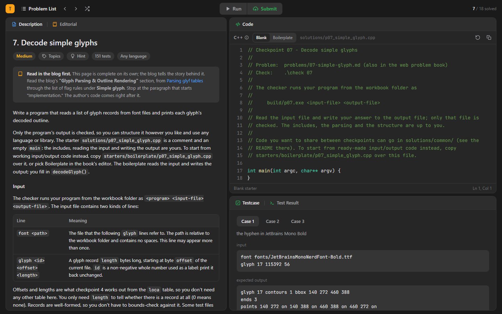
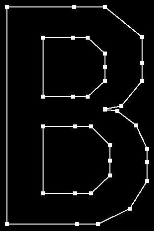
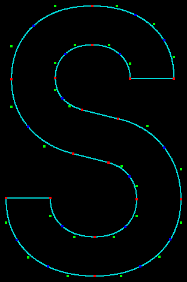
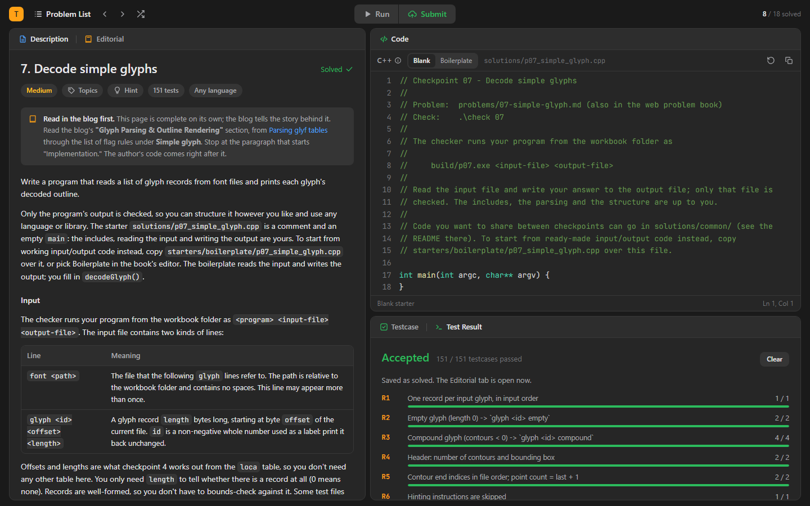
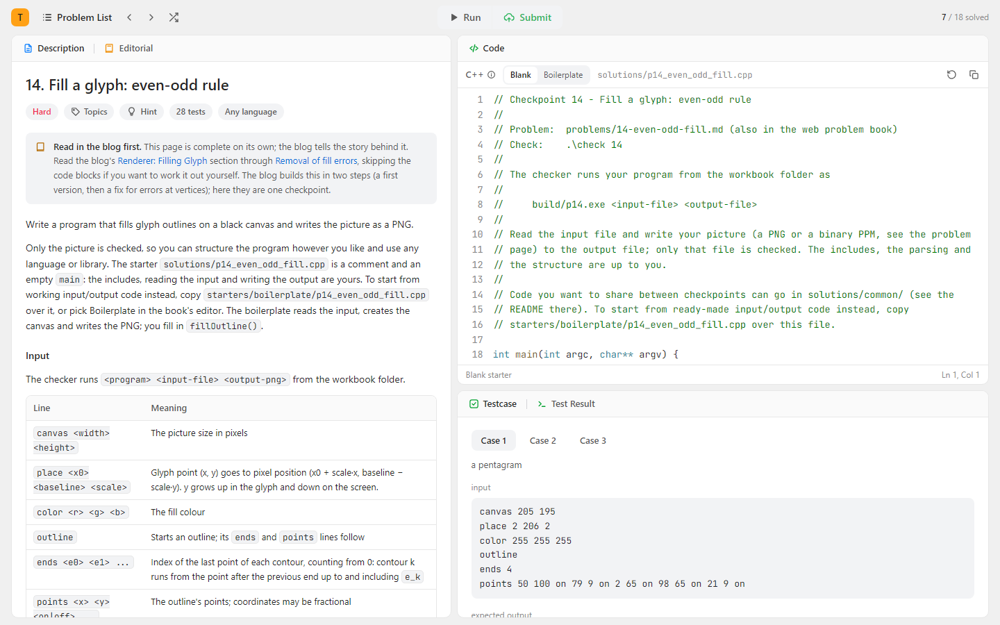

# techblog-workbooks

This repository collects tech blog posts turned into hands-on workbooks. In each workbook you
rebuild what a post builds, one assignment at a time, until you understand what the post was
teaching because you wrote it yourself.

There are two workbooks so far, and more are on their way. If you've turned a post into a
workbook, or there's a post you'd love to see here, [contributions are welcome](#contributing).

The workbooks come from [tech-blog-to-workbook](https://github.com/knmn2000/tech-blog-to-workbook),
a Claude Code plugin that reads a post and builds the assignments, tests and problem book.

Browse them on the site, [workbooks.2mbproblems.com](https://workbooks.2mbproblems.com/):
every workbook's assignments, the project you build, how to set it up, and a read-only copy of its
problem book. The site's source is in [`site/`](site), and it republishes on every push.



## Workbooks

| Workbook | Built on | Language | Assignments | What you build |
|---|---|---|---|---|
| [Tiny TrueType renderer](workbooks/tiny-truetype-renderer) | [Writing a tiny TrueType parser and renderer from scratch](https://yayo1.com/en/blog/tiny-truetype-renderer/) by Yohei Yamasaki | C++ starters; also C, Go, Rust, Python, JavaScript, TypeScript or Lua | 18, with 572 tests | A font renderer from raw bytes: the table directory, character maps, glyph outlines, Bézier curves, scanline filling, ending in a line of text |
| [Build a PKI auditor yourself](workbooks/emudhra-ca-incident) | [eMudhra Statement on Recent Certificate Security Incident](https://emudhra.com/en/post/certificate-security-incident) | Python: you build the `pkiaudit` package | 16, with 282 tests | Certificate security from the ground up: modular arithmetic and elliptic-curve point arithmetic, parsing and validating real X.509 certificates by hand, recovering the incident's own weak private key (`d = 4`) and signing with it, then the defenses that would have caught it (correct key generation, a key linter, a ceremony checker, SPKI blocklisting), ending in an audit that reports a compromised key's full blast radius |

### What you build in the TrueType workbook

Every picture below is an expected output from the workbook's tests. Your program draws the same
thing from the font file's bytes.

| 08 · Straight lines | 11 · Curves | 14 · Even-odd fill | 16 · Non-zero fill | 17 · Glyph fill |
|:---:|:---:|:---:|:---:|:---:|
|  |  |  |  |  |

Assignment 18, the last one, puts your pieces together:


## Start a workbook

```bash
git clone https://github.com/knmn2000/techblog-workbooks
cd techblog-workbooks/workbooks/tiny-truetype-renderer   # or workbooks/emudhra-ca-incident
```

Then, with the plugin installed, ask Claude Code to "set up my workbook": it checks the tools,
asks which language you want, offers to install anything missing, creates your project and opens
the book. Or double-click `study.cmd` in that folder (or run `.\study`): it opens the problem
book in your browser, with Run and Submit running your code from the page, and offers to create
the project if there isn't one yet.

In the book you get a problem list with your progress and, for each assignment, the statement,
what it adds to your project, hints that open in order, an Editorial with a solution proven to
pass, an editor with the assignment's files and the example test cases. Your code lives in your
project in `solutions/`. Each assignment's files start as the Boilerplate: the input/output code
and the declarations, with TODOs for you. To write the includes, the design, the input reading and
the output writing yourself, pick From scratch in the editor, and each file starts as a comment
saying what belongs there. You can also write in your own editor and check from a terminal with
`.\check 01`; the book picks up your saved changes.

Each workbook's own README lists what it needs (for the TrueType workbook: g++ with CMake and
Ninja, and Python 3.11 or newer; for the certificate workbook: Python 3.11 or newer, plus `openssl`
on your PATH and the `cryptography` package for fresh test sets).

## How checking works

The checker reads only your output. Each assignment's program runs as
`<program> <input-file> <output-file>`, so you choose the structure and the libraries. Claude asks
which language you want when you set a workbook up (C, C++, Go, Rust, Python, JavaScript,
TypeScript or Lua) and sets up only that one.

Expected answers come from an independent source, never from the reference solution. In the
TrueType workbook most come from [fontTools](https://github.com/fonttools/fonttools); in the
certificate workbook most come from `openssl` and the `cryptography` library. Before an assignment
ships, Claude checks the checks: the reference solution passes, planted bugs fail (including any
bug in the post's own code), different-but-correct solutions pass, and a separate solver passes
using only the problem page.

A wrong test doesn't block you: `.\check 07 -Dispute <test-id> "why"` sets a test aside, and
`.\check 07 -Fresh` gives you a new set of tests you haven't seen.

Each assignment adds source files with descriptive names, such as `GlyphParser.cpp`, to your
project in `solutions/`, laid out like the author's, and later assignments use them. After the last
assignment, the project is a program of its own that you can put on GitHub. Every test input still
carries what the earlier assignments would produce, so an assignment's tests depend only on the
earlier files it uses.

| Problem list | Test result |
|---|---|
|  |  |

The book follows your system's light or dark theme:



## Contributing

To add a workbook, install [tech-blog-to-workbook](https://github.com/knmn2000/tech-blog-to-workbook)
in Claude Code and ask it to turn a post into a workbook. Put the result in
`workbooks/<short-name>/`, add a row to the table above, and open a pull request. The site picks
the workbook up by itself; its `workbook.json` `site` block says what to install and how to start
it. Before you open the pull request, check that:

- every assignment passes the plugin's checks (reference Accepted, planted bugs fail, an
  independent solver passes from the page alone);
- `py -P tools/blank_starters.py` has run, `solutions/` isn't committed (the workbook creates a
  learner's project when they set it up), and `tools/build_book.py` has rebuilt the book with no
  warnings;
- the workbook copies nothing from the post: problem pages explain in their own words and link
  to it;
- anything bundled from elsewhere (fonts, libraries, data) has a licence that allows sharing,
  and that licence sits next to it.

To suggest a post, open an issue with the link and what you'd like to learn from it. If
`-Dispute` turned up a test you believe is wrong, open an issue with the assignment, the test id
and why.

## Licence

The workbooks' own content (problem pages, tools, tests and solutions) is under the
[Apache License 2.0](LICENSE) unless a workbook says otherwise. Fonts and third-party code keep
their own licences, noted inside each workbook (for example `fonts/README.md`). The blog posts
belong to their authors; the workbooks link to them and contain none of their text or code.
