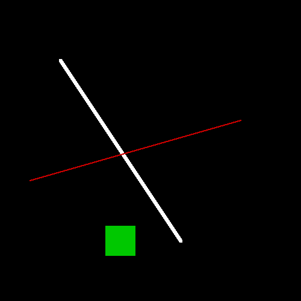

# 06 · Draw on a framebuffer

**Difficulty:** Medium · **Assignment** 6 of 18 · **Check:** `.\check 06`

**Tags**
- *Language:* structs · `std::vector` as a 2D grid · integer division · `std::swap` · converting a float to an int (rounding vs truncating)
- *Library:* `stbi_write_png` from stb_image_write (the Boilerplate already calls it)
- *Concepts:* framebuffer · row-major pixel layout · clipping · line rasterization along the longer axis · drawing order

## Read in the blog first

You can pass using this page alone. For the background, read the blog's
[Preparation of a renderer](https://yayo1.com/en/blog/tiny-truetype-renderer/#:~:text=Preparation%20of%20a%20renderer)
section up to and including the paragraph that starts "The line drawing algorithm", and stop
before the author's code that follows it.

## Source material

- Wikipedia, [Digital differential analyzer (graphics algorithm)](https://en.wikipedia.org/wiki/Digital_differential_analyzer_(graphics_algorithm)): the line method used here
- Wikipedia, [Bresenham's line algorithm](https://en.wikipedia.org/wiki/Bresenham%27s_line_algorithm): the same idea with integers only
- stb, [stb_image_write.h](https://github.com/nothings/stb/blob/master/stb_image_write.h): the PNG writer (`third_party/stb`)
- The blog: [Preparation of a renderer](https://yayo1.com/en/blog/tiny-truetype-renderer/#:~:text=Preparation%20of%20a%20renderer)

## Where this fits

In assignments 01 to 05 you read numbers out of the font file. Six later assignments draw
pictures: outlines with straight lines (08) and with curves (11), filled glyphs (14, 16, 17)
and a line of text (18). They all draw on the framebuffer you build here, in
`src/FrameBufferCanvas.h` and `.cpp`. It is a grid of pixels in memory with three operations
(paint one pixel, fill a rectangle, draw a thick line) and a way to save the grid as a PNG.

## The problem

Write a program that reads a list of drawing commands and saves the picture they draw as a PNG
file.

### Input

The checker runs your program from the workbook folder as `<program> <input-file> <output-file>`.
The output file name ends in `.png`. The input file contains these lines, one command per
line. All values are whole numbers.

| Line | Meaning |
|---|---|
| `canvas <w> <h>` | Always the first line: the picture is `w` pixels wide and `h` pixels tall, all black. |
| `point <x> <y> <r> <g> <b>` | Paint pixel (x, y) in colour (r, g, b). |
| `rect <cx> <cy> <w> <h> <r> <g> <b>` | A filled `w` x `h` rectangle centred on (cx, cy). |
| `line <ax> <ay> <bx> <by> <thickness> <r> <g> <b>` | A line from (ax, ay) to (bx, by), `thickness` pixels thick. |

Colours are 0 to 255 per channel. Coordinates can be negative or beyond the picture.

### Output

A PNG (or binary PPM) file of `w` x `h` pixels, 8 bits per channel, RGB (RGBA works too; the
checker ignores alpha). Pixel (0, 0) is the top-left corner; x grows to the right and y
grows downwards. Every pixel that no command paints stays black (0, 0, 0).

Write the picture to the output path the checker gives you. The name ends in `.png`, but the
checker looks at the contents, so either of these works:

- A binary PPM, which needs no library: the header `P6`, the width, the height and
  `255`, separated by spaces or newlines and ended by one newline (for example
  `P6\n205 195\n255\n`), then 3 bytes per pixel (red, green, blue), row by row from the
  top-left. Open the file in binary mode (`std::ios::binary`), or Windows writes every pixel
  byte 10 as two bytes.
- A real PNG: `third_party/stb_image_write.h` in your project is on the include path.
  `#define STB_IMAGE_WRITE_IMPLEMENTATION` before including it in one file, then call
  `stbi_write_png(path, width, height, 3, pixels, width * 3)`.

### The commands, in order

Draw the commands in the order they appear, so that a later command paints over an earlier
one wherever they overlap.

### Painting one pixel

`point x y ...` paints a single pixel. If (x, y) is outside the picture (x < 0, y < 0,
x ≥ w or y ≥ h), nothing happens.

The rectangle and the line paint through this operation, so its bounds check does the
clipping for every shape: a shape that crosses the edge of the picture keeps only its
inside part.

### Drawing a rectangle

`rect cx cy w h ...` paints every pixel (x, y) with

| | from | to (included) |
|---|---|---|
| x | `cx - w/2` | `cx - w/2 + w - 1` |
| y | `cy - h/2` | `cy - h/2 + h - 1` |

where `w/2` and `h/2` round down. With an odd size the centre pixel sits in the middle; with
an even size the left (or top) side gets one pixel more than the right (or bottom):

| w | columns, for cx = 100 |
|---|---|
| 1 | 100 |
| 4 | 98 ... 101 |
| 5 | 98 ... 102 |
| 50 | 75 ... 124 |

### Drawing a line

`line ax ay bx by t ...` stamps one `t` x `t` square (centred like a rectangle) for every
step along the line's longer direction:

1. If the line is steep, meaning |by - ay| > |bx - ax|, swap the roles of x and y for
   the steps below (step along y instead of x).
2. Step from the end with the smaller x to the end with the larger x, both ends included.
   With x = the step and (x1, y1), (x2, y2) the two ends in that order, the other coordinate
   is `y1 + (y2 - y1) / (x2 - x1) * (x - x1)`, worked out in floating point and rounded to
   the nearest whole number.
3. At each step, draw a `t` x `t` rectangle centred on (x, y) (on (y, x) for a steep line,
   swapping back).
4. If both ends are the same pixel, the line is a single square.

Truncating toward zero instead of rounding to the nearest also passes, and a tie at .5 may
go either way, because the checker forgives an edge that moves by one pixel. It doesn't
forgive a missing piece, a gap or a shape in the wrong place.

Compute the slope in floating point: with ints, `(by - ay) / (bx - ax)` is integer division
and loses the fraction.

### How the picture is compared

The checker reads your PNG and compares it with the expected picture pixel by pixel. It
forgives a differing pixel only when it belongs to an edge that moved by at most 1 pixel:
extra ink next to the same ink in the expected picture, or missing ink with the same ink next
to it in your picture. Every other difference counts, and every test allows 0 of them.

If a test fails, the checker writes a diff picture:

- red where you have extra ink;
- blue where ink is missing;
- magenta for the wrong colour;
- yellow for forgiven pixels.

## Requirements

Each test checks one of these requirements. If tests fail, the checker's report shows how many
pass for each requirement, and it may add a `likely cause` line that names the requirement the
difference points to.

- **R1** The picture is `w` x `h` pixels, black wherever no command paints, with (0, 0) at
  the top-left and y growing downwards.
- **R2** `point` paints one pixel, in its colour.
- **R3** `rect` covers columns `cx - w/2` to `cx - w/2 + w - 1` and rows likewise, for even
  and odd sizes.
- **R4** `line` works in every direction (shallow, steep, horizontal, vertical, either end
  first), with both ends included and no gaps, and a zero-length line is one square.
- **R5** `line` stamps a `thickness` x `thickness` square at every step.
- **R6** A shape that crosses the edge of the picture keeps its inside part, and a shape with
  no pixel inside the picture draws nothing and doesn't crash your program.
- **R7** Later commands paint over earlier ones.

## Examples

### Example 1: the blog's demo scene (test `06-E2E-blog-demo`)

```
input:   canvas 500 500
         line 100 100 300 400 5 255 255 255
         line 400 200 50 300 2 200 0 0
         rect 200 400 50 50 0 200 0

output:  a 500 x 500 PNG
```



The white line is steep (it moves 300 down and 200 across), so it steps along y. The red line
goes right to left, so your program swaps its ends before stepping along x. The red line is on
top where the two cross, because it comes later.

### Example 2: even-sized rectangles (test `06-R3-even`)

```
input:   canvas 220 140
         rect 60 70 50 50 0 200 0
         rect 160 40 20 8 255 120 170
         rect 160 100 2 2 255 255 255
         point 60 70 255 255 255
         point 160 40 60 120 255

output:  a 220 x 140 PNG
```

The green square covers columns 60 - 25 = 35 to 35 + 49 = 84 and rows 45 to 94: 25 pixels
left of the centre column, 24 to the right. The pink bar covers columns 150 to 169 and rows
36 to 43. The 2 x 2 square covers columns 159 to 160 and rows 99 to 100. The two points come
last, so they show on top of the rectangles' centres.

### Example 3: lines 1 to 3 pixels long (test `06-R4-short`)

```
input:   canvas 120 80
         line 10 10 11 10 1 255 255 255
         line 30 10 30 12 1 200 0 0
         line 50 10 52 13 1 0 200 0
         line 80 13 77 10 1 255 220 0
         line 10 50 13 49 1 0 220 220
         line 60 60 59 57 1 255 120 170

output:  a 120 x 80 PNG
```

Take the green line from (50, 10) to (52, 13). It moves 3 down and 2 across, so it is steep:
step y from 10 to 13 and work out x = 50 + 2/3 * (y - 10).

| y | x before rounding | x rounded | pixel |
|---|---|---|---|
| 10 | 50 | 50 | (50, 10) |
| 11 | 50.67 | 51 | (51, 11) |
| 12 | 51.33 | 51 | (51, 12) |
| 13 | 52 | 52 | (52, 13) |

Without the swap you would step x from 50 to 52 and paint only 3 pixels, leaving a gap.

## Constraints

- `w` and `h` are between 1 and 600. Rectangle sizes and line thicknesses are between 1 and 600
  (Hint 3 says what that means for speed).
- Coordinates are between -1000 and 1000, so a line has at most a few thousand steps.
- At most 15 colours appear in one picture, each far from the others and from black.
- Each case has a 10-second limit. A correct solution takes milliseconds.
- There are 30 tests: the blog's demo, hand-made scenes for each requirement and 5 random
  scenes.

## Hints

<details><summary>Hint 1: where to start</summary>

Get `set()` right first: it is the only function that touches the pixel array, so if it
checks the bounds, no shape can write outside the picture. Then `drawRect()` is two loops calling `set()`, and
`drawLine()` is one loop calling `drawRect()`.
</details>

<details><summary>Hint 2: the approach</summary>

Pixel (x, y) lives at index `y * width + x` of the vector. For the line, decide once whether
it is steep, swap x and y of both ends if so, and swap the ends if the first has the larger
x. After those swaps you have one case left: x goes up by 1 per step and y changes by `slope`
per step, where `|slope| <= 1`. Swap x and y back when you stamp the square.
</details>

<details><summary>Hint 3: the traps</summary>

- Check `x >= width`, not `x > width`: index `y * width + width` is the first pixel of the
  next row (or past the end of the vector on the last row).
- Without the steep swap, a line close to vertical comes out as a few dots.
- `(by - ay) / (bx - ax)` with ints is integer division. Convert to `double` first.
- A zero-length line has `bx - ax == 0`. Don't divide by it; draw one square.
- `w / 2` for the rectangle is integer division on purpose: it rounds down.
- Loop `x <= bx`, not `x < bx`, or the last end goes missing.
- A thick line stamps one rectangle per step, up to 600 x 600 pixels each, and most of a stamp
  can lie outside the canvas. Start and stop the rectangle's loops at the canvas edges, so the
  pixels outside cost nothing; `set()` would drop them anyway, one call at a time.
</details>

<details><summary>Hint 4: pseudocode</summary>

```
set(x, y, c):
    if 0 <= x < width and 0 <= y < height: pixels[y * width + x] = c

drawRect(cx, cy, w, h, c):
    left = cx - w / 2;  top = cy - h / 2          # integer division
    for y in max(top, 0) .. min(top + h, height) - 1:          # only the rows inside the canvas
        for x in max(left, 0) .. min(left + w, width) - 1: set(x, y, c)

drawLine(ax, ay, bx, by, t, c):
    steep = |by - ay| > |bx - ax|
    if steep: swap(ax, ay); swap(bx, by)
    if ax > bx: swap(ax, bx); swap(ay, by)
    slope = (bx == ax) ? 0 : (by - ay) / double(bx - ax)
    for x in ax .. bx:
        y = round(ay + slope * (x - ax))
        if steep: drawRect(y, x, t, t, c) else: drawRect(x, y, t, t, c)
```
</details>

## Checking your solution

```
.\check 06                         run every test
.\check 06 -Case 06-R4-short       one test, showing its full input and where your picture is
.\check 06 -Fresh                  a new set of tests (new random seed), to confirm on data you haven't seen
.\check 06 -Dispute <id> "why"     set aside a test you believe is wrong; you won't be blocked
```

Open your picture (`build/cases/06/<id>.out.png`) next to the expected one
(`tests/06/expected/<id>.png`) and the diff the checker writes. A failing test looks like
this:

```
  R4  line in every direction (shallow, steep, axis-aligned), both ends... .    2 / 6   FAILED
      x 06-R4-steep  steep lines (|slope| > 1) going up and down: no gaps allowed
          570 pixels missing, e.g. (20, 12) should be white (beyond the 1-pixel edge tolerance). Diff: build/cases/06/06-R4-steep.diff.png - red extra, blue missing, magenta wrong colour, yellow forgiven
          likely cause: R4 - line in every direction (shallow, steep, axis-aligned), both ends included
          expected values from: reference drawing, checked against the ideal shapes (exact pixels for point/rect, true segment for line)
          reproduce: build/solutions/assignment_06.exe build/cases/06/06-R4-steep.in build/cases/06/06-R4-steep.out.png
```

## After you pass: compare with the author's code

[The blog's first `FrameBufferCanvas`](https://yayo1.com/en/blog/tiny-truetype-renderer/#:~:text=Preparation%20of%20a%20renderer)
is a class that owns a one-dimensional vector of `RGB` pixels. `set` writes one pixel and
ignores coordinates outside the picture, `drawRect` takes the centre and size, and `drawLine`
does the steep swap, orders the ends and stamps a `drawRect` at every step. A second
`drawLine` takes 2D vectors, which keeps the glyph code in later sections short, and
`writePngFile` hands the buffer to `stbi_write_png` with 3 channels. Its `main` draws the
scene from Example 1.

The snippet turns the stepped coordinate into a pixel with a plain
cast, which truncates toward zero instead of rounding, so its lines can sit up to a pixel to
one side, and the tests accept both. It also divides by `bx - ax` without checking, so a
zero-length line divides by zero; this page asks for one square instead.
