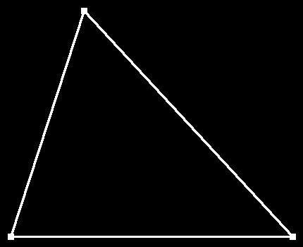
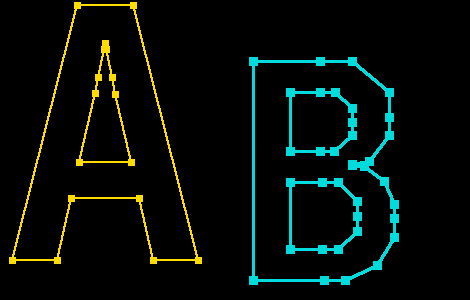

# 08 · Draw an outline with straight lines

**Difficulty:** Easy · **Assignment** 8 of 18 · **Check:** `.\check 08`

**Tags**
- *Language:* [nested loops](#primer/loops) over index ranges · [wrapping an index back to the start](#primer/conditional-operator) · [`std::lround`](#primer/float-to-int)
- *Library:* your [`FrameBufferCanvas`](#primer/framebuffer) from assignment 06 (`drawLine`, `drawRect`, `writePng`)
- *Concepts:* [glyph outlines and contours](#primer/contour) · [font units](#primer/font-units) vs pixels · [flipping the y axis](#primer/screen-coordinates) · [scale and offset](#primer/screen-coordinates) (a simple transform)

## Read in the blog first

You can pass using this page alone. For the background, read the blog's
[Render outlines as straight lines](https://yayo1.com/en/blog/tiny-truetype-renderer/#:~:text=Render%20outlines%20as%20straight%20lines)
section up to and including the paragraph that starts "The glyph coordinates are", and stop
before the author's code that follows it.

## Learning material

- [Font coordinates and screen coordinates](#primer/screen-coordinates): `Placement` in
  `render/Placement.h` holds a `place` line's x0, baseline and scale, and a point lands on pixel
  (x0 + scale * x, baseline - scale * y).
- [The baseline and the pen](#primer/baseline): the baseline is the pixel row where font y = 0
  lands, so a descender such as the tail of `g` comes out below it.
- [Contours and `endPtsOfContours`](#primer/contour): `renderGlyphOutline` splits the points
  into contours at the `ends` values and closes each contour back to its own first point.
- [The conditional operator `?:`](#primer/conditional-operator): which point follows a point
  depends on whether it is its contour's last one, and `?:` chooses between two values in one
  expression.
- [Converting a floating-point number to an integer](#primer/float-to-int): round each pixel
  position with `std::lround`, because a cast turns -2.7 into -2.
- [Drawing a line](#primer/line-drawing): each side of a contour is one call to your `drawLine`
  from assignment 06, with thickness `lineThickness`.

## Source material

- Apple, *TrueType Reference Manual*, [Digitizing Letterform Designs](https://developer.apple.com/fonts/TrueType-Reference-Manual/RM01/Chap1.html): contours, points and font units
- Microsoft, *OpenType specification*, [glyf: Glyph Data](https://learn.microsoft.com/en-us/typography/opentype/spec/glyf): how `endPtsOfContours` splits the points into contours
- The blog: [Render outlines as straight lines](https://yayo1.com/en/blog/tiny-truetype-renderer/#:~:text=Render%20outlines%20as%20straight%20lines)

## Where this fits

In assignment 07 you decoded a glyph into contours of points (the types in your
`GlyphComponent.h`), and your `FrameBufferCanvas` from assignment 06 draws lines and squares.
Here you put the two together and draw your first picture of a real glyph: every contour as a
closed polygon, with a square on each point. This assignment leaves out curves; assignment 11
adds them to the same `render/Outline` files.

## The problem

Write a program that draws glyph outlines into a PNG: straight lines between each outline's
points, and a small square on every point.

### Input

The checker runs your program from the workbook folder as `<program> <input-file> <output-file>`.
The output file name ends in `.png`. The input file contains these lines:

| Line | Meaning |
|---|---|
| `canvas <w> <h>` | Always the first line: the picture is `w` x `h` pixels, all black. |
| `place <x0> <baseline> <scale>` | Where the following outlines go (see below). |
| `style <lineThickness> <markerSize>` | Line thickness and marker size, in pixels, for the following outlines. |
| `color <r> <g> <b>` | Colour of the following outlines. |
| `outline` | Starts an outline. An `ends` line and a `points` line follow. |
| `ends <e0> <e1> ...` | Index of the last point of each contour, in increasing order. |
| `points <x> <y> <on\|off> ...` | Every point of the outline, in order, in font units. |

- The input sets `place`, `style` and `color` before the first `outline`, and may set them
  again between outlines. Each outline uses the most recent ones.
- `ends` and `points` use the format that assignment 07 prints, except that a coordinate may
  have a fractional part (e.g. `120.75`), as assignment 09 produces for scaled
  components.
- `x0`, `baseline` and `scale` may be fractional or negative. `lineThickness`, `markerSize`,
  `w`, `h` and colours are whole numbers.

### Output

A PNG (or binary PPM) file of `w` x `h` pixels, RGB. Pixel (0, 0) is the top-left corner and
pixel y grows downwards.

Your `FrameBufferCanvas` from assignment 06 can already write the picture (`writePng` in the
Boilerplate). Write it to the output path the checker gives you. The name ends in `.png`, but
the checker looks at the contents, so either of these works:

- A binary PPM: the header `P6`, the width, the height and `255`, separated by spaces or
  newlines and ended by one newline (for example `P6\n205 195\n255\n`), then 3 bytes per pixel
  (red, green, blue), row by row from the top-left. Open the file in binary mode
  (`std::ios::binary`), or Windows writes every pixel byte 10 as two bytes.
- A real PNG: `third_party/stb_image_write.h` in your project is on the include path.
  `#define STB_IMAGE_WRITE_IMPLEMENTATION` before including it in one file, then call
  `stbi_write_png(path, width, height, 3, pixels, width * 3)`.

### From font units to pixels

Glyph coordinates are in font units, which grow upwards from the baseline; pixel
coordinates grow downwards from the top. A point (x, y) in font units lands on pixel

```
px = x0 + scale * x
py = baseline - scale * y
```

rounded to the nearest whole number. This makes `x0` the pixel column where font x = 0 lands
and `baseline` the pixel row where font y = 0 lands. A point with a negative y (a descender,
like the tail of `g`) ends up below the baseline row.

### What to draw

For each outline, in input order:

1. The `ends` values split the points into contours: contour 0 is points 0 to `e0`,
   contour 1 is points `e0 + 1` to `e1`, and so on. Within each contour, draw a line
   from every point to the next one, and from the last point back to the contour's first
   point. Don't draw a line from one contour to the next. Draw each line with your
   `FrameBufferCanvas` line from assignment 06, with thickness `lineThickness`.
2. Then draw a marker on every point: a `markerSize` x `markerSize` square centred on it
   (your canvas's rectangle), covering columns x − size/2 up to x − size/2 + size − 1 with
   size/2 rounded down, and rows likewise. With an odd size the point sits in the middle; with
   an even size the left and top sides get one pixel more, so a 10-pixel marker at x = 16
   covers columns 11 to 20.

Three more rules:

- Draw the lines and the markers in the outline's colour.
- Treat `on` and `off` points the same: join every point with straight lines and give it a
  marker.
- Later outlines paint over earlier ones, though no test makes outlines of different colours
  overlap.

### How the picture is compared

The checker compares your PNG with the expected picture pixel by pixel and forgives only an
edge that moved by at most 1 pixel, so rounding a coordinate down instead of to the nearest
still passes. A missing line, a line that shouldn't be there or a shape in the wrong place
fails.

If a test fails, the checker writes a diff picture:

- red where you have extra ink;
- blue where ink is missing;
- magenta for the wrong colour;
- yellow for forgiven pixels.

## Requirements

Each test checks one of these requirements. If tests fail, the checker's report shows how many
pass for each requirement, and it may add a `likely cause` line that names the requirement the
difference points to.

- **R1** Point (x, y) lands on pixel (x0 + scale * x, baseline - scale * y), rounded, so the
  glyph stands upright on the baseline.
- **R2** A line joins each contour's last point to its first, closing the contour.
- **R3** Contours stay separate: no line joins the end of one contour to the start of the
  next.
- **R4** Every point, on-curve or off-curve, gets a `markerSize` x `markerSize` square.
- **R5** Several outlines on one canvas each use their own `place`, `style` and `color`.
- **R6** The scale applies to every coordinate, including coordinates with a fractional part.

## Examples

### Example 1: a triangle (test `08-R2-triangle`)

```
input:   canvas 430 350
         place 15 335 0.8
         style 3 9
         color 255 255 255
         outline
         ends 2
         points 0 0 on 500 0 on 130 400 off

output:  a 430 x 350 PNG
```



| Point | Font units | px = 15 + 0.8x | py = 335 - 0.8y |
|---|---|---|---|
| 0 | (0, 0) | 15 | 335 |
| 1 | (500, 0) | 415 | 335 |
| 2 | (130, 400) | 119 | 15 |

`ends 2` means one contour with points 0 to 2. The lines are 0 → 1, 1 → 2 and the closing
line 2 → 0. Point 2 is `off`, but here you join it with straight lines like the others.
Then each point gets a 9 x 9 square: point 2's covers columns 115 to 123 and rows 11 to 19.

### Example 2: the hyphen (test `08-R1-hyphen`)

```
input:   canvas 352 148
         place -124 404 1
         style 3 10
         color 255 255 255
         outline
         ends 3
         points 140 272 on 140 388 on 460 388 on 460 272 on

output:  a 352 x 148 PNG: a 320 x 116 rectangle outline from (16, 16) to (336, 132)
```

`x0` is negative here: font x = 140 lands on pixel 140 - 124 = 16. The hyphen's bottom edge
(y = 272) lands on row 404 - 272 = 132 and its top edge (y = 388) on row 16, which puts the
top edge higher in the picture.

### Example 3: two outlines (test `08-R5-two`)

```
input:   canvas 470 300
         place 0 260 0.35
         style 2 7
         color 255 220 0
         outline
         ends 7 16
         points 35 0 on 219 730 on 380 730 on 565 0 on 437 0 on 397 177 on 203 177 on 163 0 on 226 279 on 374 279 on 330 475 on 319 524 off 303 603 off 300 621 on 297 603 off 281 524 off 270 476 on
         place 230 280 0.3
         style 3 9
         color 0 220 220
         outline
         ends 17 26 35
         points 77 0 on 77 730 on 301 730 on 406 730 off 531 628 off 531 542 on 531 482 off 462 396 off 407 387 on 407 385 on 448 380 off 512 331 off 548 254 off 548 208 on 548 145 off 490 51 off 384 0 off 312 0 on 199 429 on 299 429 on 348 429 off 406 482 off 406 528 on 406 573 off 349 626 off 299 626 on 199 626 on 199 104 on 305 104 on 360 104 off 423 163 off 423 214 on 423 265 off 360 328 off 305 328 on 199 328 on

output:  a 470 x 300 PNG
```



The second outline uses the second `place`, `style` and `color`. `B` has three contours
(`ends 17 26 35`): points 0 to 17, 18 to 26 and 27 to 35, each closed on its own.

## Constraints

- `w` and `h` are at most 600. Every outline fits inside the canvas.
- An outline has at most a few hundred points; `ends` is increasing and its last value is
  the last point index.
- Each case has a 10-second limit. A correct solution takes milliseconds.
- There are 22 tests: glyphs from JetBrains Mono Bold (`-`, `A`, `B`, `D`, `S`, `a`, `g`,
  `o`), U+5341 十 and U+3042 あ from Noto Sans JP, hand-made outlines and 3 random outlines.

## Hints

<details><summary>Hint 1: where to start</summary>

Write a small function that turns one font point into a pixel (the two formulas above, then
round). Check it on Example 1 by hand before drawing anything.
</details>

<details><summary>Hint 2: the approach</summary>

Walk the contours with a running start index: contour k runs from `first` to `ends[k]`,
then `first = ends[k] + 1`. Inside a contour, the point after `i` is `i + 1`, except after
the last point, where it is `first`. Draw all lines, then loop over all points once more for
the markers.
</details>

<details><summary>Hint 3: the traps</summary>

- Subtract `scale * y` from the baseline; adding it draws the glyph upside down, with most of
  it off the canvas.
- Apply the scale to the coordinates only: `x0 + scale * x`, not `scale * (x0 + x)`.
- The closing line goes back to the contour's own first point, not to point 0 of the
  outline.
- Don't round a coordinate with a plain cast if it can be negative: `(int)-2.7` is -2.
  `std::lround` rounds to the nearest.
- Each outline may have its own `place`, `style` and `color`; use the most recent ones (the boilerplate keeps track of them for you).
</details>

<details><summary>Hint 4: pseudocode</summary>

```
pixel(p) = (round(x0 + scale * p.x), round(baseline - scale * p.y))

drawOutline(outline):
    first = 0
    for last in outline.ends:
        for i in first .. last:
            next = (i == last) ? first : i + 1
            drawLine(pixel(points[i]), pixel(points[next]), lineThickness, color)
        first = last + 1
    for p in points:
        (x, y) = pixel(p)
        drawRect(x, y, markerSize, markerSize, color)
```
</details>

## Checking your solution

```
.\check 08                         run every test
.\check 08 -Case 08-R2-triangle    one test, showing its full input and where your picture is
.\check 08 -Fresh                  a new set of tests (new random seed), to confirm on data you haven't seen
.\check 08 -Dispute <id> "why"     set aside a test you believe is wrong; you won't be blocked
```

Open your picture (`build/cases/08/<id>.out.png`) next to the expected one
(`tests/08/expected/<id>.png`) and the diff the checker writes. A failing test looks like
this:

```
  R2  Every contour is closed: its last point joins its first ..............    0 / 2   FAILED
      x 08-R2-triangle  hand-made triangle: the third side is the closing line
          1127 pixels missing, e.g. (116, 21) should be white (beyond the 1-pixel edge tolerance). Diff: build/cases/08/08-R2-triangle.diff.png - red extra, blue missing, magenta wrong colour, yellow forgiven
          likely cause: R2 - Every contour is closed: its last point joins its first
          expected values from: hand-made outline; picture checked against the ideal segments and markers
          reproduce: build/solutions/assignment_08.exe build/cases/08/08-R2-triangle.in build/cases/08/08-R2-triangle.out.png
```

## After you pass: compare with the author's code

[The blog's `renderGlyphOutline`](https://yayo1.com/en/blog/tiny-truetype-renderer/#:~:text=Glyph%20outline%20rendering%20with%20straight%20lines)
takes a start position, the glyph and a colour. It walks the contours with a running start
index, and at a contour's last point it sets the next point back to the contour's first
point, as Hint 2 does. It draws each line with thickness 5 and puts a 20 x 20 square on
the current point in the same loop. Its `main` draws `a` from JetBrains Mono Bold at
(300, 300) on a 1200 x 1200 canvas; test `08-E2E-blog-a` is the same picture at half size.

The snippet doesn't flip y itself. It adds the start position to
the font coordinates and asks stb to turn the whole image upside down when it writes the PNG.
That works for one glyph, but the start position then counts from the bottom of the
picture. This page uses an explicit baseline instead, which the later assignments need when
several glyphs share a line of text; the blog switches to a transform matrix
(`setGlyphBaseline`) for the same reason in its curve section.

The snippet passes the float coordinates straight to the integer `drawLine` and `drawRect`,
so C++ truncates them toward zero instead of rounding. With whole font units and a whole
start position nothing moves; with fractional coordinates, as assignment 09 produces, a point
can shift by a pixel.

The author's repository keeps only the later `renderGlyphOutline`, the curve version from
assignment 11, and its `writePngFile` no longer flips the picture.
