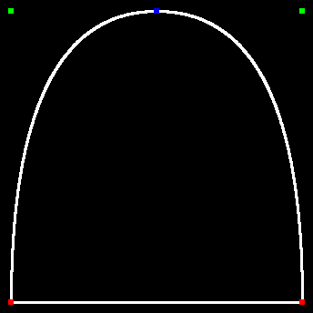
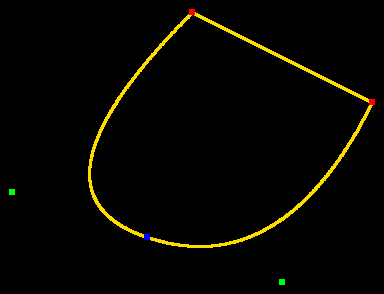
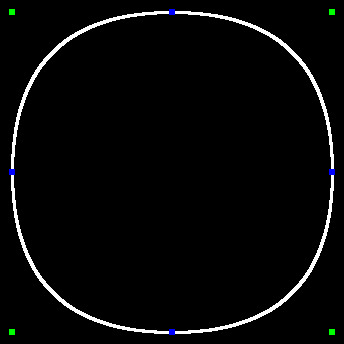

# 11 · Draw an outline with curves

**Difficulty:** Medium · **Assignment** 11 of 18 · **Check:** `.\check 11`

**Tags**
- *Language:* walking a circular list with an [index modulo its length](#primer/integer-division) · a small [2D vector](#primer/vector-2d) struct · floating-point arithmetic, [rounding only at the end](#primer/float-to-int)
- *Library:* your [`FrameBufferCanvas`](#primer/framebuffer) from assignment 06 (`drawLine`, `drawRect`, `writePng`)
- *Concepts:* [quadratic Bézier curves](#primer/bezier) · [on-curve and off-curve points](#primer/on-off-curve) · [implied on-curve points](#primer/implied-point) · [flattening a curve](#primer/flattening) into short lines

## Read in the blog first

You can pass using this page alone. For the background, read the blog's
"Renderer: Curve Rendering" section through
[TrueType Bézier curves](https://yayo1.com/en/blog/tiny-truetype-renderer/#:~:text=TrueType%20B%C3%A9zier%20curves)
and stop at the sentence that introduces the code. The author's code follows it.

## What you need

- [On-curve and off-curve points](#primer/on-off-curve): the walk ends a straight line at an
  on-curve point and uses an off-curve point as a curve's control point, where assignment 08
  joined both kinds with lines.
- [Implied on-curve points](#primer/implied-point): between two off-curve points in a row,
  `renderGlyphCurves` ends one curve and starts the next at their midpoint, which gets a blue
  marker.
- [Flattening a curve](#primer/flattening): each curve becomes n short lines between points from
  your `bezierLerp`, with n = max(1, ceil(|P1 - P0| + |P2 - P1|)) in pixels.
- [Integer division and `%`](#primer/integer-division): index a contour's points modulo its
  length, so the point after the last is the first and the walk can go all the way round.
- [`<cmath>`](#primer/cmath): `std::hypot` measures the two legs of the control polygon for n,
  and `std::ceil` rounds their sum up.

## Source material

- Apple, *TrueType Reference Manual*, [Digitizing Letterform Designs](https://developer.apple.com/fonts/TrueType-Reference-Manual/RM01/Chap1.html): quadratic curves, on-curve and off-curve points, and the implied point between two off-curve points
- FreeType, [Glyph Conventions: outlines](https://freetype.org/freetype2/docs/glyphs/glyphs-6.html): the same rules, with pictures
- Wikipedia, [Bézier curve: quadratic curves](https://en.wikipedia.org/wiki/B%C3%A9zier_curve#Quadratic_B%C3%A9zier_curves)
- The blog: [TrueType Bézier curves](https://yayo1.com/en/blog/tiny-truetype-renderer/#:~:text=TrueType%20B%C3%A9zier%20curves)

## Where this fits

In assignment 08 you joined every point of an outline with a straight line. TrueType outlines
also contain quadratic curves: an off-curve point pulls the outline toward itself without
lying on it.

Here you draw outlines with their curves, using your curve function in `utils/Geometry.h`
from assignment 10. Assignments 13, 14 and 17 use the same pieces (lines and curves) to fill
glyphs.

## The problem

Your program reads one or more glyph outlines and draws each one with straight lines and
quadratic curves. It marks every point with a coloured square and writes the picture as a
PNG.

### Input

The checker runs your program from the workbook folder as `<program> <input-file> <output-file>`.
The output file name ends in `.png`. The input is the same as in assignment 08, except that
`style` has one number (there is no marker size):

| Line | Meaning |
|---|---|
| `canvas <w> <h>` | The first line of the file: the picture is `w` x `h` pixels, all black. |
| `place <x0> <baseline> <scale>` | Where the following outlines go (see below). |
| `style <lineThickness>` | Thickness of lines and curves, in pixels, for the following outlines. |
| `color <r> <g> <b>` | Colour of the lines and curves of the following outlines. |
| `outline` | Starts an outline. An `ends` line and a `points` line follow. |
| `ends <e0> <e1> ...` | Index of the last point of each contour, in increasing order. |
| `points <x> <y> <on\|off> ...` | Every point of the outline, in order, in font units. |

`place`, `style` and `color` come before the first `outline` and may change between
outlines; each outline uses the most recent ones. Coordinates may have a fractional part.

### Output

Your program writes a PNG (or binary PPM) file of `w` x `h` pixels, RGB, with (0, 0) at the
top-left and y growing downwards.

Write the picture to the output path the checker gives you. The name ends in `.png`, but the
checker looks at the contents, so a PNG and a binary PPM both work.

- `writePng` on your `FrameBufferCanvas` from assignment 06 writes a PNG. The boilerplate
  calls it.
- To write a binary PPM by hand, write the header `P6`, the width, the height and `255`,
  separated by spaces or newlines and ended by one newline (for example `P6\n205 195\n255\n`),
  then 3 bytes per pixel (red, green, blue), row by row from the top-left. Open the file in
  binary mode (`std::ios::binary`), or Windows writes every pixel byte 10 as two bytes.
- To write a PNG without the canvas, use `third_party/stb_image_write.h`, which is on your
  project's include path. `#define STB_IMAGE_WRITE_IMPLEMENTATION` before including it in one
  file, then call `stbi_write_png(path, width, height, 3, pixels, width * 3)`.

### From font units to pixels

A point (x, y) in font units sits at

```
px = x0 + scale * x
py = baseline - scale * y
```

Keep these as floating-point numbers. Work out curves and implied points from them, and round
to whole pixels only when you draw. Your `FrameBufferCanvas::drawLine` from assignment 06
takes whole pixels, so round each end to the nearest pixel (`std::lround`) as you call it; a
cast to `int` cuts off the fraction instead of rounding.

Rounding every point first, as in assignment 08, moves a curve by less than a pixel and also
passes.

### Walking a contour

`ends` splits the points into contours as in assignment 08: contour 0 is points 0 to `e0`,
contour 1 is points `e0 + 1` to `e1`, and so on. Each contour closes on itself: after its last
point comes its first point again.

Go round a contour keeping a current position: the point where the next piece starts. The
current position is an on-curve point, real or implied. Each point you reach adds one piece
that starts at the current position:

| Point reached | The point after it | Piece | Current position becomes |
|---|---|---|---|
| on-curve | (doesn't matter) | a straight line to it | this point |
| off-curve | on-curve | a curve with this point as control point, ending at the point after it, which the walk then skips | the point after it |
| off-curve | off-curve | a curve with this point as control point, ending at the implied on-curve point halfway between the two | the implied point |

If two off-curve points follow each other, the outline passes through the point halfway
between them. The font doesn't store that point; it is an implied on-curve point, where
one curve ends and the next begins. The last and the first point of a contour count as
neighbours.

Every piece starts at an on-curve point, real or implied, so start the walk at the first
on-curve point of the contour and go round the contour back to it. The walk ends when it
reaches the starting point again:

- if the contour's last point is on-curve, the final piece is a line back to the start;
- if it is off-curve, the final piece is a curve that ends at the start.

A contour with k off-curve control points gives k curves. If the contour has no on-curve
point, start at the implied point halfway between its last and first points.

The start rule matters for two kinds of contour:

- a contour whose first point is off-curve: its first curve starts at the last on-curve
  point of the contour (or at the implied point between its last and first points), not
  at (0, 0);
- a contour with only off-curve points, such as a circle made of 4 or 8 control points: it is
  a ring of curves joined at implied points.

### Drawing a curve

The quadratic Bézier curve from P0 to P2 with control point P1 is

```
B(t) = (1 - t)² P0 + 2 (1 - t) t P1 + t² P2,     t from 0 to 1
```

Draw it as `n` short straight lines from B((i - 1) / n) to B(i / n) for i = 1 to n, where

```
n = max(1, ceil(|P1 - P0| + |P2 - P1|))       lengths in pixels
```

The curve is no longer than its control polygon (P0 to P1 to P2), so each short line is
about a pixel long at most. More pieces are fine; much fewer, such as a fixed 8, leave visible
corners on long curves.

Lines and curves both use thickness `lineThickness` and the outline's colour.

### Markers

Draw the markers after all the lines and curves of an outline: a square of size
`2 * lineThickness` on each point, rounded to the nearest pixel. The size is even, so the
square covers columns x − lineThickness up to x + lineThickness − 1 (and rows likewise), as
your `FrameBufferCanvas::drawRect` from assignment 06 does: a 6 x 6 marker at x = 50 covers
columns 47 to 52. The colour depends on the point:

| Point | Colour |
|---|---|
| every on-curve point of the input | red (255, 0, 0) |
| every off-curve point of the input | green (0, 255, 0) |
| every implied on-curve point | blue (0, 0, 255) |

Markers go on top of the lines, so each square shows its full colour. In the tests, markers of
different colours don't overlap, so you can draw them in any order.

### How the picture is compared

The checker compares your PNG with the expected picture pixel by pixel. The one difference it
forgives is an edge that moved by at most 1 pixel, so small rounding differences pass. A
straight line where a curve should be, a missing marker or a marker of the wrong colour fails.

If a test fails, the checker writes a diff picture:

- red where you have extra ink;
- blue where ink is missing;
- magenta for the wrong colour;
- yellow for forgiven pixels.

## Requirements

Each test checks one of these requirements. If tests fail, the checker's report shows how many
pass for each requirement, and it may add a `likely cause` line that names the requirement the
difference points to.

- **R1** A straight line joins two on-curve points in a row, including the last and first
  point of a contour.
- **R2** An off-curve point between two on-curve points makes one quadratic curve between
  them, drawn as short lines.
- **R3** Two off-curve points in a row have an implied on-curve point halfway between them.
  One curve ends there and the next starts there, and the point gets a blue marker.
- **R4** Your program draws every piece of a contour that starts with an off-curve point or
  has no on-curve point, the closing curve included.
- **R5** Markers are `2 * lineThickness` squares on top of the lines: red on-curve, green
  off-curve, blue implied.
- **R6** `place` positions the points (x0 + scale * x, baseline - scale * y), and several
  outlines on one canvas each use their own `place`, `style` and `color`.

## Examples

### Example 1: two off-curve points in a row (test `11-R3-two-offs`)

```
input:   canvas 344 344
         place 12 332 0.8
         style 3
         color 255 255 255
         outline
         ends 3
         points 0 0 on 0 400 off 400 400 off 400 0 on

output:  a 344 x 344 PNG
```



In pixels the points are A (12, 332) on, B (12, 12) off, C (332, 12) off and D (332, 332)
on. B and C are both off-curve, so the outline passes through the implied point halfway
between them, M = (172, 12). The pieces are:

| Piece | From | Control | To | n |
|---|---|---|---|---|
| curve | A (12, 332) | B (12, 12) | M (172, 12) | 320 + 160 = 480 |
| curve | M (172, 12) | C (332, 12) | D (332, 332) | 160 + 320 = 480 |
| line | D (332, 332) | | A (12, 332) | |

Then draw 6 x 6 markers: red on A and D, green on B and C, blue on M.

### Example 2: a contour that starts off-curve (test `11-R4-off-first`)

```
input:   canvas 384 294
         place 12 282 0.9
         style 3
         color 255 220 0
         outline
         ends 3
         points 300 0 off 400 200 on 200 300 on 0 100 off

output:  a 384 x 294 PNG
```



In pixels: P0 (282, 282) off, P1 (372, 102) on, P2 (192, 12) on, P3 (12, 192) off. Start at
P1, the first on-curve point, and go round:

1. P2 is on-curve: a line P1 → P2.
2. P3 is off-curve and so is the next point, P0 (the walk has wrapped round): a curve from P2
   with control P3 to the implied point (147, 237).
3. P0 is off-curve and the next point, P1, is on-curve: a curve from (147, 237) with control
   P0 back to P1.

If you start at P0 with a "previous point" of (0, 0), you draw the first curve from (12, 282),
where font (0, 0) lands, and miss the curve from the implied point into P1.

### Example 3: only off-curve points (test `11-R4-circle4`)

```
input:   canvas 344 344
         place 12 332 0.8
         style 3
         color 255 255 255
         outline
         ends 3
         points 0 0 off 0 400 off 400 400 off 400 0 off

output:  a 344 x 344 PNG
```



There is no on-curve point, so start at the implied point between the last and first
points: halfway between (332, 332) and (12, 332), which is (172, 332). Each of the 4 points
is then the control point of one curve, and the 4 curves meet at 4 implied points (blue).

## Constraints

- `w` and `h` are at most 600. Every outline fits inside the canvas.
- Every contour has at least 3 points. An outline has at most a few hundred points.
- Each case has a 10-second limit. A correct solution takes milliseconds.
- There are 27 tests: glyphs from JetBrains Mono Bold (`-`, `A`, `B`, `D`, `S`, `a`, `g`,
  `o`), Nerd Font icons from the same file whose contours start off-curve or have no
  on-curve point (U+F111, U+F10C, U+E3A2, U+F00C, U+F042), `a` and U+5341 十 from Noto Sans JP,
  hand-made outlines and 3 random outlines.

## Hints

<details><summary>Hint 1: where to start</summary>

Before you start, open the expected pictures for Example 1 and Example 3: the blue markers
show where curves join. Write `drawQuadratic()` first and test it on Example 1's numbers.
Then copy your loop from assignment 08 and change what happens at an off-curve point.
</details>

<details><summary>Hint 2: the approach</summary>

Convert the contour's points to pixels (as floats) and index them modulo the contour's
length, so the point after the last is the first. Keep a `current` position: where the next
piece starts. Find the first on-curve point and start there (or start at the midpoint of the
last and first points if there is none). Then, for each point after the start, all the way
round: an on-curve point ends a straight line; an off-curve point ends a curve at the next
point if that is on-curve (skip it, since the curve used it) or at the midpoint with the next point.
Each time, `current` becomes the end of what you drew. Collect the markers as you go and draw
them after the loop.
</details>

<details><summary>Hint 3: the traps</summary>

- Don't start the walk at point 0 with `current = (0, 0)`: a contour whose first point is
  off-curve then starts its first curve in the wrong place and loses its closing curve.
- A contour can have no on-curve point at all (`fa-circle`, U+F111, is 8 off-curve points).
  Make sure your search for an on-curve start point doesn't loop forever or fall off the end.
- After a curve that ends at a real on-curve point, don't draw a line to that point again.
- The midpoint test also applies across the wrap: the last and first points of a contour are
  neighbours.
- Draw markers after all lines, or later lines cross earlier markers.
- Use the pixel positions for the piece count: `n` from font units would be far too many at
  a small scale (still correct, but slow) or too few at a large one.
</details>

<details><summary>Hint 4: pseudocode</summary>

```
drawQuadratic(p0, p1, p2):
    n = max(1, ceil(|p1 - p0| + |p2 - p1|))
    prev = p0
    for i in 1 .. n:
        t = i / n
        next = (1-t)² p0 + 2(1-t)t p1 + t² p2
        drawLine(prev, next, lineThickness, color)
        prev = next

drawOutline(outline):
    markers = []
    for each contour (pixel points q[0..m-1], q[k] means q[k mod m]):
        s = index of the first on-curve point, or none
        if s exists: current = q[s]; k = s + 1; stop = s + m + 1
        else:        current = mid(q[m-1], q[0]); k = 0; stop = m
        while k < stop:
            if q[k] is on:        drawLine(current, q[k]); current = q[k]; k += 1
            elif q[k+1] is on:    drawQuadratic(current, q[k], q[k+1]); current = q[k+1]; k += 2
            else:                 mid = mid(q[k], q[k+1]); drawQuadratic(current, q[k], mid); current = mid; k += 1
        for i in 0 .. m-1:
            add marker (q[i], red if on else green)
            if q[i] and q[i+1] are both off: add marker (mid(q[i], q[i+1]), blue)
    for each marker: drawRect(round(x), round(y), 2 * lineThickness, 2 * lineThickness, colour)
```
</details>

## Checking your solution

```
.\check 11                         run every test
.\check 11 -Case 11-R4-off-first   one test, showing its full input and where your picture is
.\check 11 -Fresh                  a new set of tests (new random seed), to confirm on data you haven't seen
.\check 11 -Dispute <id> "why"     set aside a test you believe is wrong; you won't be blocked
```

Open your picture (`build/cases/11/<id>.out.png`) next to the expected one
(`tests/11/expected/<id>.png`) and the diff the checker writes. A failing test looks like
this:

```
  R3  Two off-curve points in a row: implied on-curve point halfway (blue) .    0 / 4   FAILED
      x 11-R3-two-offs  hand-made: two off-curve points in a row, implied point between them
          2263 pixels missing, e.g. (169, 9) should be blue; 2353 extra pixels, e.g. (306, 11) should be black (beyond the 1-pixel edge tolerance). Diff: build/cases/11/11-R3-two-offs.diff.png - red extra, blue missing, magenta wrong colour, yellow forgiven
          likely cause: R3 - Two off-curve points in a row: implied on-curve point halfway (blue)
          expected values from: hand-made outline; reference drawing, checked against fontTools' pieces and implied points
          reproduce: build/solutions/assignment_11.exe build/cases/11/11-R3-two-offs.in build/cases/11/11-R3-two-offs.out.png
```

## After you pass: compare with the author's code

[The blog's curve renderer](https://yayo1.com/en/blog/tiny-truetype-renderer/#:~:text=Glyph%20outline%20rendering%20with%20curves)
replaces the start position with a transform matrix: `setGlyphBaseline` moves the glyph to
its baseline and `transformVec2` maps a point to the picture. The new `renderGlyphOutline`
walks each contour once, and `drawBezier` flattens a curve with `quadBezierLerp`, using the
ceiling of the control polygon's length as the number of pieces, as on this page. Its markers
are twice the line thickness and coloured red, green and blue, as here.

The snippet keeps a "previous point" that starts at (0, 0) and
doesn't reset it between contours. A contour whose first point is off-curve therefore starts
its first curve from that stale point and skips its real closing curve. The JetBrains Mono
Nerd Font has over two thousand such contours, most of them in icons, and R4's tests cover
them. The snippet also draws each marker inside the walk, so a line drawn later can cross an
earlier marker. On this page you draw all markers last.

After every off-curve point the snippet puts a blue marker on the end of the curve, whether that
end is an implied point or a real on-curve point. Most real points get their red marker
later in the walk, drawn over the blue one. A contour's first point gets its red marker before
the walk comes back round, so when the contour's last point is off-curve, that first point
stays blue. JetBrains Mono has about 16,500 such contours, including both
contours of `a` in test `11-R5-big-markers`. R5 asks for red there, because the point is a
real on-curve point from the font.

The blog's prose marks on-curve points in white, and its code uses red, as this page does. The
author's repository also multiplies the transform by a `scale` (`scale * transformMat`), which
scales the start position and baseline along with the glyph, so both count in font units there.
