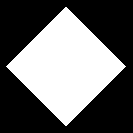
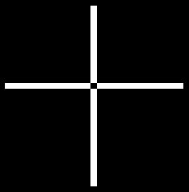

# 14 · Fill a glyph: even-odd rule

**Difficulty:** Hard · **Assignment** 14 of 18 · **Check:** `.\check 14`

**Tags**
- *Language:* [sorting](#primer/algorithm) · [floating-point comparisons](#primer/epsilon) · [solving a quadratic equation](#primer/quadratic-equation)
- *Library:* [`std::vector`](#primer/vector) · [`std::sort`](#primer/algorithm) · [`std::sqrt`](#primer/cmath)
- *Concepts:* [scanline filling](#primer/scanline) · [the even-odd rule](#primer/even-odd) · [quadratic Bézier curves](#primer/bezier) · [implied on-curve points](#primer/implied-point) · [half-open intervals](#primer/half-open)

## Read in the blog first

The blog's
[Renderer: Filling Glyph](https://yayo1.com/en/blog/tiny-truetype-renderer/#:~:text=Renderer%3A%20Filling%20Glyph)
section is an optional companion read, down to
[Removal of fill errors](https://yayo1.com/en/blog/tiny-truetype-renderer/#:~:text=Removal%20of%20fill%20errors);
skip the code blocks if you'd rather work it out yourself. The author builds the fill in two passes,
a first version and then a fix for errors at vertices, and this assignment includes both.

## Learning material

- [Scanline filling](#primer/scanline): `render/Scanline` is the machinery both fill rules
  share. `edgePieces` turns an outline into edges in pixels, `forEachRow` gives each row its
  crossings sorted by x, and `fillSpan` paints one stretch of a row.
- [`<functional>`](#primer/functional): `forEachRow` in `render/Scanline.h` takes the work for
  each row as a `std::function`. The even-odd fill here and the non-zero fill in assignment 16
  each hand it their own lambda.
- [The even-odd rule](#primer/even-odd): `renderGlyphByEvenOdd` in `render/EvenOdd.cpp` fills
  from the 1st crossing to the 2nd, the 3rd to the 4th, and so on, which is why the middle of
  the star in test `14-R5-star` stays empty.
- [Half-open edges](#primer/half-open): an edge counts at a row when min(y0, y1) ≤ y < max(y0, y1),
  so a vertex sitting on a pixel centre, as in test `14-R4-diamond-half`, leaves no stray line.
- [Splitting a curve where y turns](#primer/curve-turning-point): `edgePieces` cuts each curve
  at t = (y0 − y1) / (y0 − 2·y1 + y2), which leaves every piece crossing a row at most once.
- [Solving a quadratic equation](#primer/quadratic-equation): each curve piece needs y(t) = row
  solved, keeping the one root closest to [0, 1], clamped. Assignment 13 kept every root in
  [0, 1]; this one doesn't.
- [Converting a floating-point number to an integer](#primer/float-to-int): `fillSpan` turns a
  crossing's x into a column. Clamp x to the canvas first, because C++ leaves the conversion of
  a `double` too large for an `int` undefined.

## Source material

- Wikipedia, [Even–odd rule](https://en.wikipedia.org/wiki/Even%E2%80%93odd_rule)
- Apple, *TrueType Reference Manual*, [Digitizing Letterform Designs](https://developer.apple.com/fonts/TrueType-Reference-Manual/RM01/Chap1.html): on-curve and off-curve points
- Pomax, [A Primer on Bézier Curves](https://pomax.github.io/bezierinfo/): finding extremities and intersections
- The blog: [Even-odd Rule](https://yayo1.com/en/blog/tiny-truetype-renderer/#:~:text=Even-odd%20Rule) and [Removal of fill errors](https://yayo1.com/en/blog/tiny-truetype-renderer/#:~:text=Removal%20of%20fill%20errors)

## Where this fits

Here you fill the outlines from assignments 07 and 09 (your `GlyphComponent`). The
row-by-row scanning goes in `render/Scanline`. Assignments 16 and 17 reuse it for the
non-zero rule, and assignment 18 renders whole lines of text with the non-zero fill.

## The problem

Fill glyph outlines on a black canvas by the even-odd rule, and save the picture as a PNG.

### Input

Invoked from the workbook folder: `<program> <input-file> <output-png>`.

| Line | Meaning |
|---|---|
| `canvas <width> <height>` | The picture size in pixels |
| `place <x0> <baseline> <scale>` | Glyph point (x, y) goes to pixel position (x0 + scale·x, baseline − scale·y). y grows up in the glyph and down on the screen. |
| `color <r> <g> <b>` | The fill colour |
| `outline` | Starts an outline; its `ends` and `points` lines follow |
| `ends <e0> <e1> ...` | Index of the last point of each contour, counting from 0: contour k runs from the point after the previous end up to and including `e_k` |
| `points <x> <y> <on\|off> ...` | The outline's points; coordinates may be fractional |

Several outlines may follow one another. Fill each one on its own, in the same colour.

### Output

A PNG (or binary PPM), `width` x `height` pixels, all black (0, 0, 0) to begin with. Paint a pixel in the fill colour when its centre is inside an outline by the
even-odd rule. Pixel (px, py), with py counted down from the top, has its centre at screen position
(px + 0.5, py + 0.5), which is glyph point ((px + 0.5 − x0) / scale, (baseline − py − 0.5) / scale).

An edge that lands one pixel off is forgiven. Sampling at the top of each row instead of the
centre, or rounding x another way, still passes. Missing or extra shapes, holes in the wrong
place and stray lines fail.

Save the picture to the path you're given. It ends in `.png`, but the checker inspects what is in
the file, so it takes a binary PPM as well as a PNG:

- `writePng` on your `FrameBufferCanvas` (assignment 06) is what the boilerplate calls. Calling
  stb yourself works too, since `third_party/stb_image_write.h` is on your project's include path:
  `#define STB_IMAGE_WRITE_IMPLEMENTATION` ahead of the include in a single file, then
  `stbi_write_png(path, width, height, 3, pixels, width * 3)`.
- Or write the bytes as a binary PPM: a header of `P6`, the width, the height and `255`, with spaces
  or newlines between fields and one newline to end it (for example `P6\n205 195\n255\n`), then red,
  green and blue bytes for each pixel, in rows from the top-left. The stream needs
  `std::ios::binary`; in text mode, Windows writes a pixel byte of 10 as two bytes.

### From points to edges

Every contour is a closed loop: after its last point it continues to its first. Walk the points
in order, the way your `render/Outline` did when it drew curves in assignment 11:

- Two on-curve points in a row make a straight line.
- An off-curve point is the control point of a quadratic Bézier curve from the previous on-curve
  point to the next on-curve point: B(t) = (1−t)²·P0 + 2(1−t)t·P1 + t²·P2 for t from 0 to 1.
- Two off-curve points next to each other have an implied on-curve point at their midpoint.
  Each off-curve point then has on-curve points on both sides.
- A contour can start with an off-curve point, and can even consist only of off-curve points
  (then each of its on-curve points is an implied one).

The blog finds each crossing with the functions from assignments 12 and 13. Those count a
segment's endpoints and keep t = 0 and t = 1, so a vertex on a scanline comes back from both
of its edges, twice. Call them if you like, but apply the half-open rule below first to decide
which edges count at that row. The alternative is to solve for the crossing from the edge
itself, as this page does.

### The even-odd rule

Draw a ray from the point to the right and count how many times it crosses the outline. Odd
means inside, even means outside.

A scanline is a horizontal line through a row of pixel centres. Per row, the rule becomes:

1. Find every x where the scanline crosses an edge.
2. Sort the crossings by x.
3. Fill between the 1st and 2nd, the 3rd and 4th, and so on.

The trouble starts when a scanline passes through a vertex, a point where two edges meet. A
naive count sees that point twice and flips the rest of the row (a stray line), or misses a
crossing it should have counted. The fix is to treat each edge as half-open in y:

- An edge from y0 to y1 counts at scanline y when min(y0, y1) ≤ y < max(y0, y1), with y measured
  on the screen (pixels, growing downward).
- A horizontal edge doesn't count.

A vertex the outline passes through now counts once. A pointed tip (both edges above, or both
below) counts twice or not at all, and the parity comes out right either way.

A quadratic curve can cross one scanline twice. Split each curve where its y turns around and
each piece crosses a scanline at most once. The half-open rule then works for curves too.

- For a curve P0, P1, P2 the turning point is at t = (P0.y − P1.y) / (P0.y − 2·P1.y + P2.y). Split
  only if the denominator is nonzero and 0 < t < 1. Otherwise the curve is already monotone: it only
  rises or only falls.
- Both halves use the same split point, with the same y.
- To find where a piece crosses scanline y, solve y(t) = y as a quadratic in t (linear when
  P0.y − 2·P1.y + P2.y = 0). Take one root per piece: the one closest to [0, 1] (either one if
  both are inside), clamped to [0, 1]. At a scanline through a split point the quadratic
  formula returns two equal roots, both in [0, 1], so keeping every root in [0, 1] counts that
  crossing twice. Tests `14-R2-o` and `14-R2-8` have such rows. The clamp also rescues a root
  that a rounding error pushes outside [0, 1].

Crossings can land far outside the canvas. Clamp x to the canvas before converting it to an
integer, because C++ doesn't define what happens when a huge double becomes an `int`. The
function that fills a stretch of a row (the boilerplate's `fillSpan`) should skip columns
outside the canvas and do nothing for an empty stretch.

## Requirements

A test checks one requirement. Failure reports total the passes per requirement; a `likely cause`
line sometimes follows, naming the requirement the difference points to.

- **R1** Fill each pixel whose centre is inside, and leave every other pixel black.
- **R2** A contour inside another is a hole and stays empty.
- **R3** Follow the curves, including implied on-curve points and contours that start off-curve or
  have only off-curve points.
- **R4** Count each vertex that lies on a scanline the right number of times, so no stray lines
  appear.
- **R5** Where contours cross or overlap, the even-odd rule leaves the overlap empty.
- **R6** Fill several outlines one after another, painting their union.
- **R7** Apply the placement and scale, and clip anything outside the canvas.

## Examples

### Example 1: a pentagram (test `14-R5-star`)

```
input:   canvas 205 195
         place 2 206 2
         color 255 255 255
         outline
         ends 4
         points 50 100 on 79 9 on 2 65 on 98 65 on 21 9 on
```

The star is one contour that crosses itself. A ray starting in the pentagon at the middle crosses the
outline an even number of times, and the even-odd rule leaves the pentagon black:


### Example 2: a vertex on a pixel centre (test `14-R4-diamond-half`)

```
input:   canvas 133 133
         place 5 128 1.5
         color 255 255 255
         outline
         ends 3
         points 41 1 on 1 41 on 41 81 on 81 41 on
```

A diamond with corners at (41, 1), (1, 41), (41, 81) and (81, 41), placed at scale 1.5. Every
corner lands on a pixel centre, which puts a vertex on the scanline of those rows. Under
the half-open rule the side corners count once (one edge above, one below) and the top and
bottom tips count twice or zero times. The diamond comes out clean, with no stray horizontal
line:



### Example 3: crossing strokes (test `14-R5-ten`)

```
input:   canvas 234 238
         place -9 214 0.25
         color 255 255 255
         outline
         ends 3 7
         points 62 443 on 945 443 on 945 414 on 62 414 on 486 829 on 516 829 on 516 -70 on 486 -70 on
```

U+5341 (十) from Noto Sans JP is two overlapping rectangles. Even-odd leaves the little square
where they cross empty; the non-zero rule of assignment 16 fills it.



## Constraints

- Canvases are at most about 560 x 560 pixels, and an outline has a few hundred points at most.
- Outlines are well-formed, with at least 2 points in every contour.
- 28 tests: hand-made shapes for each rule, letters from JetBrains Mono Bold at several scales,
  U+5341 from Noto Sans JP, and 6 random letters (new ones with `-Fresh`). Each case has 10 seconds.

## Hints

<details><summary>Hint 1: where to start</summary>

Get the outline into a list of edges first (lines and quadratic curves, in pixel coordinates),
then fill row by row. Your `render/Outline` from assignment 11 (drawing curves) already covers
most of the first step.
</details>

<details><summary>Hint 2: the approach</summary>

For each pixel row, take the horizontal line through the pixel centres (y = row + 0.5). Collect
the x of every place an edge crosses it, sort the list, and fill from the 1st crossing to the
2nd, the 3rd to the 4th, and so on. Fill a pixel when its centre x (px + 0.5) falls in one
of those ranges.
</details>

<details><summary>Hint 3: the traps</summary>

- Half-open intervals in y (min ≤ y < max) make a shared vertex count once. Skip horizontal
  edges.
- Split each quadratic curve where its y turns around (t = (y0 − yc) / (y0 − 2·yc + y2), with yc
  the control point's y, when 0 < t < 1), so each piece crosses a row at most once.
- Between two off-curve points, add their midpoint as an implied on-curve point.
- A contour may start off-curve: begin the walk at an on-curve point (or an implied one).
- The y axis flips: pixel y = baseline − scale·glyph y.
</details>

<details><summary>Hint 4: pseudocode</summary>

```
edges = []
for each contour:
    pts = points mapped to pixels, with midpoints inserted between consecutive off-curve points
    rotate pts so it starts at an on-curve point
    walk around: on->on adds a line; on->off->on adds a curve (split at its y turning point)

for row in 0 .. height-1:
    y = row + 0.5
    xs = []
    for e in edges:
        if min(e.y0, e.y1) <= y < max(e.y0, e.y1):
            xs.append(x where e crosses y)      # line: interpolate; curve: solve the quadratic in t
    sort xs
    for i in 0, 2, 4, ...:
        fill pixels px with xs[i] <= px + 0.5 < xs[i+1]
```
</details>

## Checking your solution

```
.\check 14                         run every test
.\check 14 -Case 14-R5-star        one test: its input, and where the expected and your pictures are
.\check 14 -Fresh                  new random letters (new seed)
.\check 14 -Dispute <id> "why"     set aside a test you believe is wrong; you won't be blocked
```

A failing picture comes with a diff image:

```
  R4  A vertex on a scanline counts the right number of times .................    4 / 5   FAILED
      x 14-R4-W  'W' at scale 0.5: vertices sharing a row
          26 extra pixels, e.g. (145, 115) should be black (beyond the 1-pixel edge tolerance).
          Diff: build/cases/14/14-R4-W.diff.png - red extra, blue missing, magenta wrong colour, yellow forgiven
```

## After you pass: compare with the author's code

The blog's [even-odd renderer](https://yayo1.com/en/blog/tiny-truetype-renderer/#:~:text=Glyph%20rendering%20with%20Even-odd%20rule)
loops over every pixel row of the canvas and every point of the outline. The helpers from
assignments 12 and 13 intersect the row with each line or curve, the author cuts the crossing x down to
an integer, and horizontal lines connect the pairs. The scanline runs along
the row's top edge (integer y) instead of through the pixel centres. The vertex fix counts an
edge only when the edge's lowest y (on screen) is above the scanline, and curves that cross
twice get a convexity check (assignment 15 finds the curve's lowest point).

Its transform multiplies the start x and the baseline by `scale` too, so it takes them in font
units where this page's `place` takes pixels. The listing uses `scale` without defining it; in
the author's repository, `setScale` sets it. Paired with `segmentsIntersect`, which accepts a
crossing at either end of an edge, the vertex fix amounts to the half-open rule with the open end
at the top: an edge counts below its top, down to and including its bottom.

The fixed version differs from this page in these places:

- A curve that bulges down the screen and meets the row twice goes through a branch for an
  endpoint on the scanline. That branch compares the row y with the endpoints' x coordinates, so
  it seldom fires, and when it doesn't the curve adds neither crossing. Rows across the bottom
  of an arc that dips below both its ends stay empty, as at the bottom of test
  `14-R3-circle-all-off`.
- The previous on-curve point starts at (0, 0) and carries over from one contour to the next, as
  in the outline renderer of assignment 11. A contour that starts with an off-curve point (R3)
  gets a wrong first curve and loses its closing one.
- `segmentsIntersect` meets the scanline only between x = 0 and the image width, while the curve
  function treats it as an infinite line. A straight edge that crosses the row left of the
  canvas is lost, and the rest of that row fills inverted (R7, test `14-R7-clipped`).
- A row that touches the lowest point on screen of a curve that bulges down gets one crossing
  from it instead of zero or two, which also inverts the rest of the row. That point has to lie
  on an integer row, which is uncommon.
