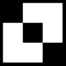

# 16 · Fill a polygon: non-zero rule

**Difficulty:** Medium · **Assignment** 16 of 18 · **Check:** `.\check 16`

**Tags**
- *Language:* [sorting pairs](#primer/algorithm) · [signed counters](#primer/integer-types)
- *Library:* [`std::vector`](#primer/vector) · [`std::sort`](#primer/algorithm)
- *Concepts:* [the non-zero winding rule](#primer/nonzero) · [edge direction](#primer/nonzero) · [scanline filling](#primer/scanline) · [half-open intervals](#primer/half-open)

## Read in the blog first

Background, if you want it: the blog's
[Non-zero Rule](https://yayo1.com/en/blog/tiny-truetype-renderer/#:~:text=Non-zero%20Rule) section.
Stop at the sentence about considering only line segments for now, because the author's code starts
right after. The page doesn't rely on it.

## Learning material

- [The non-zero winding rule](#primer/nonzero): the Boilerplate leaves `renderGlyphByNonZero` in
  `render/NonZero.cpp` for you to fill in. The assignment needs a running count per row's crossings,
  +1 for an edge going down the screen and −1 going up, with the fill wherever the count isn't 0.
- [Half-open edges](#primer/half-open): assignment 14's rule comes back, because a vertex on a
  scanline must produce one crossing with the right direction (R5).

## Source material

- Wikipedia, [Nonzero-rule](https://en.wikipedia.org/wiki/Nonzero-rule)
- Apple, *TrueType Reference Manual*, [Digitizing Letterform Designs](https://developer.apple.com/fonts/TrueType-Reference-Manual/RM01/Chap1.html): contour direction
- The blog: [Non-zero Rule](https://yayo1.com/en/blog/tiny-truetype-renderer/#:~:text=Non-zero%20Rule)

## Where this fits

The even-odd fill from assignment 14 punches a hole wherever two contours overlap. TrueType
uses the non-zero rule, which fills the overlap when both contours wind the
same way. `render/NonZero` goes on top of `render/Scanline`, and for now the outlines are
polygons; curves wait for 17.

## The problem

Fill polygon outlines (straight edges only) with the non-zero rule on a black canvas, and write the
result as a PNG.

### Input

The checker passes the input path and the PNG path to your program:
`<program> <input-file> <output-png>`, in the workbook folder.

| Line | Meaning |
|---|---|
| `canvas <width> <height>` | The picture size in pixels |
| `place <x0> <baseline> <scale>` | Outline point (x, y) goes to pixel position (x0 + scale·x, baseline − scale·y). y grows up in the outline and down on the screen. |
| `color <r> <g> <b>` | The fill colour |
| `outline` | Starts an outline; its `ends` and `points` lines follow |
| `ends <e0> <e1> ...` | Index of the last point of each contour, counting from 0: contour k runs from the point after the previous end up to and including `e_k` |
| `points <x> <y> on ...` | The outline's points. In this assignment every point is on-curve, so every edge is a straight line. |

An input can hold several outlines. Fill them one after another in the same colour, each with its
own winding count (see below), so a pixel gets the fill colour if any outline fills it.

### Output

The picture is `width` x `height` pixels, as a PNG (or binary PPM), and starts black. A pixel gets
the fill colour if its centre falls inside an outline by the non-zero rule. Pixel (px, py) counts py
down from the top and has its centre at (px + 0.5, py + 0.5) on screen.

The checker tolerates a one-pixel shift of an edge, so sampling at the top of each row instead of the centre,
or rounding x another way, still passes. Missing or extra shapes and stray lines fail.

The checker accepts a PNG or a binary PPM, whichever you write: it reads the contents and ignores
the `.png` ending of the output name.

- The boilerplate already calls `writePng` on `FrameBufferCanvas`, your class from assignment 06. To
  go straight to stb, `third_party/stb_image_write.h` is reachable through the include path; one
  file needs `#define STB_IMAGE_WRITE_IMPLEMENTATION` above that include, and the call is
  `stbi_write_png(path, width, height, 3, pixels, width * 3)`.
- A binary PPM by hand uses the layout from assignment 06: `P6`, width, height, `255` (spaces or
  newlines between them, a newline after the last) (for example `P6\n205 195\n255\n`), then one RGB
  triple of bytes per pixel, going row after row from the top-left. Open the file with
  `std::ios::binary`; otherwise Windows stores each pixel byte equal to 10 as two bytes.

### The non-zero rule

Each contour closes up, with its last point connecting back to its first, and each edge has a
direction: from a point to the next one.

To test a point, shoot a ray to the right and keep a winding count starting at 0. Every edge the
ray crosses adds 1 if it heads down the screen (y grows from its start to its end) and subtracts
1 if it heads up. The opposite signs work as long as all edges use the same ones; this page and
the hints use down = +1. The point is inside when the final count is not zero.

- Two overlapping contours going the same way give 2 in the overlap. Still inside, no hole.
  Even-odd would leave one.
- A contour inside another and going the opposite way gives 1 − 1 = 0, a hole. That's how fonts
  hollow out an `o` or a `#`.
- A counter-clockwise contour by itself gives −1, and that's inside too, so the test is "not
  zero", not "greater than zero".

With scanlines, for each row:

1. Collect each crossing as (x, direction).
2. Sort the crossings by x.
3. Walk left to right with a running count and fill the stretches where it isn't zero.

Vertices need the half-open treatment from assignment 14 so they count the right number of times:

- Count an edge at scanline y when min(y0, y1) ≤ y < max(y0, y1), with y in screen pixels, growing
  downward.
- A horizontal edge doesn't count.

That makes a vertex the outline passes through count once, with the right direction.

Clamp crossing x values to the canvas before they become integers. `fillSpan` (assignment 14) should
skip columns outside the canvas and do nothing for an empty stretch.

## Requirements

One requirement per test. A failing run totals passes by requirement, and may add a `likely cause`
line for the requirement the difference suggests.

- **R1** Fill each pixel whose centre is inside, and leave every other pixel black.
- **R2** Fill the overlap of contours that go the same way.
- **R3** A contour going the opposite way inside another cuts a hole.
- **R4** Fill a contour that goes counter-clockwise on its own.
- **R5** Count each vertex that lies on a scanline the right number of times, with the right
  direction.
- **R6** Fill several outlines one after another, painting their union.
- **R7** Apply the placement and scale, and clip anything outside the canvas.

## Examples

### Example 1: a pentagram (test `16-R2-star`)

```
input:   canvas 205 195
         place 2 206 2
         color 255 255 255
         outline
         ends 4
         points 50 100 on 79 9 on 2 65 on 98 65 on 21 9 on
```

The star from assignment 14 again. The outline winds around the central pentagon twice (count 2),
so the non-zero rule fills it:


### Example 2: squares going opposite ways (test `16-R3-opposite-overlap`)

```
input:   canvas 133 133
         place 6 126 2
         color 255 255 255
         outline
         ends 3 7
         points 0 0 on 0 40 on 40 40 on 40 0 on 60 20 on 60 60 on 20 60 on 20 20 on
```

The first square runs clockwise and the second counter-clockwise, so the overlap sums to 0:



### Example 3: crossing strokes (test `16-R2-ten`)

```
input:   canvas 234 238
         place -9 214 0.25
         color 255 255 255
         outline
         ends 3 7
         points 62 443 on 945 443 on 945 414 on 62 414 on 486 829 on 516 829 on 516 -70 on 486 -70 on
```

U+5341 (十) from Noto Sans JP is two rectangles going the same way. Even-odd left the crossing
empty in assignment 14; the non-zero rule fills it.


## Constraints

- Every point is on-curve, and no canvas is bigger than about 560 x 560 pixels.
- A contour has at least 2 points.
- 24 tests: hand-made polygons for each rule, straight-line letters from JetBrains Mono Bold, and
  straight-line characters from Noto Sans JP (the random picks change with `-Fresh`). The limit is 10 seconds
  a case.

## Hints

<details><summary>Hint 1: where to start</summary>

Begin with your scanline fill from assignment 14 (`render/Scanline`). The edges and crossings stay
as they were. Only your handling of the sorted crossings changes.
</details>

<details><summary>Hint 2: the approach</summary>

Store each crossing as its x plus a direction, +1 for an edge going down the screen and −1 for
one going up. Sort by x, walk left to right adding the directions, and fill each stretch between
two crossings whose running count isn't zero.
</details>

<details><summary>Hint 3: the traps</summary>

- "Inside" means count ≠ 0. Fill a lone counter-clockwise contour, which gives −1.
- Direction comes from the edge's own order (point i to point i + 1), not from the endpoints after
  sorting by y.
- Keep the half-open rule (min ≤ y < max) and skip horizontal edges.
- The last point connects back to the first point of its own contour, not the first of the whole
  outline.
</details>

<details><summary>Hint 4: pseudocode</summary>

```
edges = [(p[i], p[i+1]) for each contour, wrapping at its end], mapped to pixels
for row in 0 .. height-1:
    y = row + 0.5
    crossings = []
    for (a, b) in edges:
        if min(a.y, b.y) <= y < max(a.y, b.y):
            x = a.x + (y - a.y) * (b.x - a.x) / (b.y - a.y)
            crossings.append((x, +1 if b.y > a.y else -1))
    sort crossings by x
    count = 0
    for i in 0 .. len(crossings) - 2:
        count += crossings[i].direction
        if count != 0:
            fill pixels px with crossings[i].x <= px + 0.5 < crossings[i+1].x
```
</details>

## Checking your solution

```
.\check 16                         run every test
.\check 16 -Case 16-R4-reversed    one test: its input, and where the expected and your pictures are
.\check 16 -Fresh                  new random glyphs (new seed)
.\check 16 -Dispute <id> "why"     set aside a test you believe is wrong; you won't be blocked
```

## After you pass: compare with the author's code

The blog's [line-only version](https://yayo1.com/en/blog/tiny-truetype-renderer/#:~:text=Considering%20line%20direction%20at%20intersection%20counting)
works the way this page describes: each crossing is an `Intersection` holding an x and an
`isUpward` flag, and a running count goes along the sorted list. `isUpward` is true when the edge
goes up the screen (`currentPt.y > nextPt.y`), and that adds 1. The Boilerplate's `Crossing` has
the opposite sign, +1 for down, which fills the same pixels under the non-zero test.

The snippet differs from this page in these places:

- It fills a stretch only when the count before it is greater than zero (its second condition,
  that the count after it isn't negative, always holds then: the count before is at least 1, and one crossing changes it by 1). Fine for fonts whose outer contours
  are all clockwise. A contour wound the other way on its own (test
  `16-R4-reversed`) stays empty, though, and the non-zero rule says to fill it wherever the count isn't zero.
- Its scanline is a segment from x = 0 to the image width, so an edge crossing the row left of
  the canvas adds no crossing and the count is off by one for the rest of that row (R7).
- The short excerpt paints with the constant `WHITE`. The full listing after it, the one with
  curves, paints with its `color` argument.
