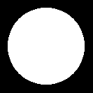
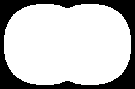
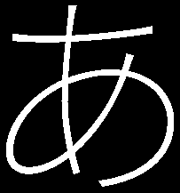

# 17 · Fill a glyph: non-zero rule

**Difficulty:** Hard · **Assignment** 17 of 18 · **Check:** `.\check 17`

**Tags**
- *Language:* [sorting](#primer/algorithm) · [solving a quadratic equation](#primer/quadratic-equation) · [floating-point care](#primer/epsilon)
- *Library:* [`std::vector`](#primer/vector) · [`std::sort`](#primer/algorithm) · [`std::sqrt`](#primer/cmath)
- *Concepts:* [the non-zero winding rule](#primer/nonzero) · [quadratic Bézier curves](#primer/bezier) · [implied on-curve points](#primer/implied-point) · [curve direction](#primer/nonzero) · [splitting curves at their y extremes](#primer/curve-turning-point)

## Read in the blog first

You can pass using this page alone. For the background, read the blog's
[Non-zero Rule](https://yayo1.com/en/blog/tiny-truetype-renderer/#:~:text=Non-zero%20Rule)
section to the end, including the two cases where a scanline crosses one curve twice. Skip the
code blocks if you want to work it out yourself.

## Learning material

- [Splitting a curve where y turns](#primer/curve-turning-point): the pieces `edgePieces` makes
  in assignment 14 now also give each crossing its direction, from the piece's end y minus its
  start y.
- [The non-zero winding rule](#primer/nonzero): at the bottom of a `U` one curve crosses a row
  twice, going down at one crossing and up at the other, so the running count changes by +1 at
  one and by −1 at the other.
- [Half-open edges](#primer/half-open): a row that touches a curve's extreme counts it twice with
  opposite directions or not at all, and neither changes the fill (R5).
- [Variable fonts](#primer/variable-font): test `17-R3-a-hiragana` draws あ from Noto Sans JP, a
  variable font whose strokes overlap, and the non-zero rule fills the overlaps.

## Source material

- Wikipedia, [Nonzero-rule](https://en.wikipedia.org/wiki/Nonzero-rule)
- Pomax, [A Primer on Bézier Curves](https://pomax.github.io/bezierinfo/): extremities and splitting curves
- Apple, *TrueType Reference Manual*, [Digitizing Letterform Designs](https://developer.apple.com/fonts/TrueType-Reference-Manual/RM01/Chap1.html)
- The blog: [Non-zero Rule](https://yayo1.com/en/blog/tiny-truetype-renderer/#:~:text=Non-zero%20Rule)

## Where this fits

In assignment 16 you filled straight-line outlines with the non-zero rule. Real glyphs have
curves, and a curve can cross one scanline twice, going up at one crossing and down at the other.
In this assignment you extend your `render/NonZero` from assignment 16 to curves, using the curve
splitting in your `render/Scanline` from assignment 14. The text renderer in assignment 18 fills
every glyph with this fill.

## The problem

Write a program that fills glyph outlines, curves included, on a black canvas with the non-zero
rule and saves the picture as a PNG.

### Input

The checker runs `<program> <input-file> <output-png>` from the workbook folder.

| Line | Meaning |
|---|---|
| `canvas <width> <height>` | The picture size in pixels |
| `place <x0> <baseline> <scale>` | Glyph point (x, y) goes to pixel position (x0 + scale·x, baseline − scale·y). y grows up in the glyph and down on the screen. |
| `color <r> <g> <b>` | The fill colour |
| `outline` | Starts an outline; its `ends` and `points` lines follow |
| `ends <e0> <e1> ...` | Index of the last point of each contour, counting from 0: contour k runs from the point after the previous end up to and including `e_k` |
| `points <x> <y> <on\|off> ...` | The outline's points; coordinates may be fractional |

There can be several outlines. Fill each one on its own, one after another, in the same colour.
Compound glyphs arrive already resolved into one outline (assignment 09's job).

### Output

A PNG (or binary PPM) `width` pixels wide and `height` pixels high, black to begin with. Paint a
pixel in the fill colour when its centre (px + 0.5, py + 0.5) is inside an outline by the
non-zero rule. The checker forgives edges that move by one pixel; missing or extra shapes and
stray lines fail.

Write the picture to the output path you're given. The name ends in `.png`, but the checker
looks at the contents, so a PNG and a binary PPM both work:

- Your `FrameBufferCanvas` from assignment 06 writes a PNG with `writePng`, and the boilerplate
  calls it. Underneath, `third_party/stb_image_write.h` is on your project's include path:
  `#define STB_IMAGE_WRITE_IMPLEMENTATION` before including it in one file, then call
  `stbi_write_png(path, width, height, 3, pixels, width * 3)`.
- To write the bytes yourself, use a binary PPM. The header is `P6`, the width, the height and
  `255`, separated by spaces or newlines and ended by one newline (for example
  `P6\n205 195\n255\n`). Then come 3 bytes per pixel (red, green, blue), row by row from the
  top-left. Open the file in binary mode (`std::ios::binary`), or Windows writes every pixel
  byte 10 as two bytes.

### From points to edges

Every contour is a closed loop: after its last point it continues to its first. Walk the points as
in assignment 14:

- Two on-curve points in a row make a straight line.
- An off-curve point is the control point of a quadratic Bézier curve from the previous on-curve
  point to the next one: B(t) = (1−t)²·P0 + 2(1−t)t·P1 + t²·P2 for t from 0 to 1.
- Two off-curve points next to each other have an implied on-curve point halfway between
  them.
- A contour can start with an off-curve point, or consist only of off-curve points.

### The non-zero rule with curves

Every edge has a direction, from a point to the next one. For each place a scanline crosses the
outline, note the x and whether the outline is going down or up the screen there (+1 or −1). Sort by
x, keep a running count from left to right, and fill wherever the count isn't zero.

A curve can cross one scanline twice. At the bottom of a `U`, the curve goes down then up, so its
two crossings have opposite directions. Split each curve at the point where its y turns around:
for y(t) = (1−t)²·y0 + 2(1−t)t·y1 + t²·y2 that is t = (y0 − y1) / (y0 − 2·y1 + y2), when the
denominator isn't 0 and 0 < t < 1. Each piece is then monotone, going only up or only down. A
monotone piece crosses a scanline at most once, and its direction comes from comparing its end's
y with its start's y.

To find a crossing on a line, interpolate. For a curve piece, solve y(t) = scanline y, a
quadratic in t: a·t² + b·t + c = 0 with a = y0 − 2·y1 + y2, b = 2·(y1 − y0) and c = y0 − scanline y
(linear when a = 0). Take one root per piece: the one closest to [0, 1] (either one if
both are inside), clamped to [0, 1]. A scanline through a split point gives two equal roots, both
in [0, 1], so keeping every root in [0, 1] counts that crossing twice; 7 of this assignment's
tests, such as `17-R1-o` and `17-R5-tangent`, have such rows. The clamp also covers a root that
a rounding error puts outside [0, 1]. The crossing's x is (1−t)²·x0 + 2(1−t)t·x1 + t²·x2.
Bisection on t also works, since each piece is monotone.

For vertices and touching scanlines, treat every piece as half-open in y: it counts at scanline
y when min(y_start, y_end) ≤ y < max(y_start, y_end). A scanline that touches a curve's extreme
without crossing it then counts it either:

- twice, with opposite directions, when the extreme is the smaller y of both pieces, or
- not at all, when the extreme is the larger y of both.

Neither case changes the fill.

Crossings can lie far outside the canvas, for example at large scales. Clamp x to the canvas
before you convert it to an integer pixel index, because C++ doesn't define what happens when you
convert a huge double to `int`.

## Requirements

Each test checks one of these requirements. If tests fail, the checker's report shows how many
pass for each requirement, and it may add a `likely cause` line that names the requirement the
difference points to.

- **R1** Fill each pixel whose centre is inside a curved outline, and no others.
- **R2** Handle implied on-curve points, and contours that start with an off-curve point or have
  only off-curve points.
- **R3** Fill the overlap of curved contours that go the same way.
- **R4** A contour going the opposite way inside another cuts a hole.
- **R5** Get the count right where a scanline crosses one curve twice or touches its extreme.
- **R6** Fill several outlines one after another; compound glyphs arrive as one outline.
- **R7** Apply the placement and scale, and clip anything outside the canvas.

## Examples

### Example 1: a contour with no on-curve points (test `17-R2-all-off`)

```
input:   canvas 133 133
         place 6 126 1
         color 255 255 255
         outline
         ends 7
         points 119.53 60 off 102.1 17.9 off 60 0.47 off 17.9 17.9 off 0.47 60 off 17.9 102.1 off
                60 119.53 off 102.1 102.1 off
```

(The `points` line is one line in the real input.) All eight points are off-curve, so each
on-curve point is an implied midpoint. The curves between them make a circle:



### Example 2: two overlapping round shapes (test `17-R3-two-circles`)

```
input:   canvas 223 148
         place -1 149 1.5
         color 255 255 255
         outline
         ends 7 15
         points 95 50 on 95 5 off 50 5 on 5 5 off 5 50 on 5 95 off 50 95 on 95 95 off
                145 50 on 145 5 off 100 5 on 55 5 off 55 50 on 55 95 off 100 95 on 145 95 off
```

(One `points` line in the real input.) Two contours of four curves each, both going the same way,
overlap in the middle. The overlap has a count of 2, so the non-zero rule fills it; the even-odd
rule would leave a hole.



### Example 3: overlapping strokes in a real glyph (test `17-R3-a-hiragana`)

Noto Sans JP draws U+3042 (あ) as overlapping curved strokes, as many variable fonts do. Its
outline has 106 points; `.\check 17 -Case 17-R3-a-hiragana` prints the full input.



## Constraints

- Canvases are at most about 560 x 560 pixels; outlines have at most a few hundred points.
- Every contour has at least 2 points.
- There are 24 tests: hand-made curved shapes for each rule, letters from JetBrains Mono Bold,
  characters from Noto Sans JP, and 7 random glyphs (new ones with `-Fresh`). Each case has 10
  seconds.

## Hints

<details><summary>Hint 1: where to start</summary>

Run `.\check 17` first: if your `render/Scanline` from assignment 14 already splits curves and
records each crossing's direction, your non-zero fill from assignment 16 may pass already.
Otherwise combine the two: assignment 14's `render/Scanline` (curves into edges, crossings per
row) and assignment 16's `render/NonZero` (counting with directions). The new part is giving
each curve crossing the right direction.
</details>

<details><summary>Hint 2: the approach</summary>

Turn each contour into lines and curves in pixel coordinates. Split every curve at its y turning
point so each piece is monotone in y. After that, every piece, line or curve, crosses a row at
most once, with a direction you can read from its endpoints. Then fill as in assignment 16.
</details>

<details><summary>Hint 3: the traps</summary>

- After splitting, solve the piece's quadratic for the scanline y and take one root: the one
  closest to [0, 1], clamped to [0, 1]. Two equal roots come back when the scanline passes
  through a split point. If the quadratic coefficient is 0, the equation is linear.
- The direction of a curve piece is its end's y compared with its start's y, not the control point.
- Insert implied midpoints and handle contours that start off-curve, as in assignment 14.
- Fill where the count is not zero, of either sign.
</details>

<details><summary>Hint 4: pseudocode</summary>

```
pieces = []
for each contour (pixel coordinates, implied points inserted, starting on-curve):
    on->on:      pieces.append(line(a, b))
    on->off->on: split curve(a, c, b) at t = (a.y - c.y) / (a.y - 2c.y + b.y) if 0 < t < 1
                 pieces.extend(the one or two monotone curves)

for row in 0 .. height-1:
    y = row + 0.5
    crossings = []
    for p in pieces:
        if min(p.start.y, p.end.y) <= y < max(p.start.y, p.end.y):
            x = crossing x (line: interpolate; curve: solve for t in [0, 1], then B(t).x)
            crossings.append((x, +1 if p.end.y > p.start.y else -1))
    sort by x; walk with a running count; fill where count != 0
```
</details>

## Checking your solution

```
.\check 17                         run every test
.\check 17 -Case 17-R5-U           one test: its input, and where the expected and your pictures are
.\check 17 -Fresh                  new random glyphs (new seed)
.\check 17 -Dispute <id> "why"     set aside a test you believe is wrong; you won't be blocked
```

## After you pass: compare with the author's code

The blog's [non-zero renderer](https://yayo1.com/en/blog/tiny-truetype-renderer/#:~:text=Fixing%20the%20counting%20error%20of%20B%C3%A9zier%20curve)
doesn't split curves. If a scanline meets a curve twice, the renderer decides the two directions
from the curve's convexity (`isBezierConvexUpwards`, the a > 0 test of assignment 15): a lambda
`nearestX` picks the crossing nearer the curve's start, which gets one direction, and the crossing
nearer its end gets the opposite. A curve met once takes its direction from its two ends. The
renderer scans only the rows inside each component's bounding box, and fills each component of a
compound glyph on its own.

The listing differs from this page in these places:

- Like the line-only version, it fills only where the count is positive, so a contour wound the
  other way on its own would stay empty (assignment 16, test `16-R4-reversed`).
- `nearestX` compares x distances, not t. When both ends of a curve are nearer the same crossing,
  that crossing gets both directions and the other gets none. The curve from (0, 0) through
  (100, 100) to (10, 0) meets the row y = 32 at x = 32.4 and 38.4, and both ends are nearer 32.4.
- The bounding box comes from the component's own glyph header, before the compound glyph's
  offset moves it, so the renderer scans a component moved up or down over the wrong rows. In
  JetBrains Mono, ’ (U+2019) is the low quote, whose box runs from y = −160 to 145, moved up by
  585 (1170 in the author's parser, see assignment 09). The renderer scans rows where none of it
  lies and draws nothing. The dots of · (U+00B7) and ŀ (U+0140) vanish the same way.
- The previous on-curve point starts at (0, 0) and carries over between contours, as in
  assignments 11 and 14, so a contour that starts off-curve (R2, test `17-R2-off-first`) gets a
  wrong first curve and loses its closing one.
- If a curve meets the row twice and one of its ends lies on the scanline, both the curve and the
  neighbouring edge count that end. The even-odd version tried to handle this case; this one has
  no rule for it. A row that touches a curve's lowest point on screen gets one crossing instead of
  zero or two. Both need a point that lies on an integer row, so they seldom show.
- A straight edge that crosses the row left of the canvas adds no crossing, as in assignment 16.
