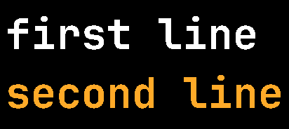
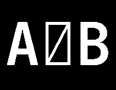

# 18 · Render a line of text

**Difficulty:** Hard · **Assignment** 18 of 18 · **Check:** `.\check 18`

**Tags**
- *Language:* [UTF-8 decoding](#primer/utf-8) · [organising a larger program](#primer/header-files) · [reusing your own code](#primer/include)
- *Library:* [`std::ifstream`](#primer/fstream) (binary) · [`std::unordered_map`](#primer/unordered-map) · [`std::vector`](#primer/vector)
- *Concepts:* the whole pipeline: [table directory](#primer/table-directory), [cmap](#primer/cmap), [loca](#primer/loca), [hmtx](#primer/hmtx), [simple](#primer/glyf) and [compound glyphs](#primer/compound-glyph), [non-zero filling](#primer/nonzero), [advance widths](#primer/hmtx)

## Read in the blog first

You can pass using this page alone. In this assignment you reach the blog's goal: a program that
loads a Unicode font, draws any string with it and saves the result as a PNG. Skim the
[Goal](https://yayo1.com/en/blog/tiny-truetype-renderer/#:~:text=Goal) section and the final
pictures in the [Non-zero Rule](https://yayo1.com/en/blog/tiny-truetype-renderer/#:~:text=Non-zero%20Rule) section.

## What you need

- [UTF-8](#primer/utf-8): `utf8ToCodepoints` in `utils/Unicode.h` turns the bytes of each `text`
  line into code points, and the R1 tests use 2-, 3- and 4-byte characters.
- [Glyph 0 and `.notdef`](#primer/notdef): `glyphFor` in `TextRenderer.cpp` returns 0 for a code
  point the cmap doesn't map, so U+0378 in test `18-R2-unmapped` draws as a box with a slash.
- [Variable fonts](#primer/variable-font): your `TextRenderer` reads Noto Sans JP's `glyf`
  outlines and `hmtx` advances and skips its `gvar` and `HVAR` tables, which gives the font's
  default instance, its Thin weight.
- [Font units and the em](#primer/font-units): each `pen` line gives the scale in pixels per font
  unit, and `main.cpp` works one out from a pixel height and the font's ascent and descent.
- [Running a program from the terminal](#primer/command-line): once you build the `tiny_ttf`
  target, `tiny_ttf <font.ttf> "<text>" <out.png>` draws your own text, in quotes when it has
  spaces.
- [Git and GitHub](#primer/git): after this assignment `solutions/` is a complete C++ project with
  its own `README.md` and `.gitignore`, ready to commit and put on GitHub.

## Source material

- Wikipedia, [UTF-8](https://en.wikipedia.org/wiki/UTF-8): the byte patterns
- Apple, *TrueType Reference Manual*: ['cmap'](https://developer.apple.com/fonts/TrueType-Reference-Manual/RM06/Chap6cmap.html), ['loca'](https://developer.apple.com/fonts/TrueType-Reference-Manual/RM06/Chap6loca.html), ['hmtx'](https://developer.apple.com/fonts/TrueType-Reference-Manual/RM06/Chap6hmtx.html), ['glyf'](https://developer.apple.com/fonts/TrueType-Reference-Manual/RM06/Chap6glyf.html)
- The blog: [Goal](https://yayo1.com/en/blog/tiny-truetype-renderer/#:~:text=Goal)

## Where this fits

In assignments 01 to 17 you built the pieces one at a time. Here you put them together, going from
the bytes of a font file and a string of text to a picture of that text. This is the last part of
your project: `TextRenderer` uses the files of assignments 02 to 17, and `main.cpp` turns the
project into a program you can run, `tiny_ttf <font.ttf> "<text>" <out.png>`.

## The problem

Write a program that draws lines of text with a TrueType font and saves the picture as a PNG.

### Input

The checker runs `<program> <input-file> <output-png>` from the workbook folder.

| Line | Meaning |
|---|---|
| `font <path>` | The TrueType font to use (relative to the workbook folder) |
| `canvas <width> <height>` | The picture size in pixels; it starts black |
| `pen <x> <baseline> <scale>` | Where the next text starts: the first glyph's origin is at pixel position (x, baseline). `scale` is pixels per font unit. |
| `color <r> <g> <b>` | The colour of the next text |
| `text <...>` | Text to draw, in UTF-8, from after the space following `text` to the end of the line (spaces included) |

- `pen`, `color` and `text` can repeat.
- A `text` line starts where the pen is: at the most recent `pen` line, moved right by any text
  drawn since. (The boilerplate passes the pen x on from one `text` line to the next.)
- Draw later text on top of earlier text.

### Output

A PNG (or binary PPM) `width` pixels wide and `height` pixels high. For each character, in order:

1. Decode UTF-8 into Unicode code points. A code point takes 1 to 4 bytes: `0xxxxxxx`,
   `110xxxxx 10xxxxxx`, `1110xxxx 10xxxxxx 10xxxxxx` or `11110xxx 10xxxxxx 10xxxxxx 10xxxxxx`.
2. Find the glyph with the font's cmap: the format 12 subtable with platform 0, encoding 4
   (your `font/Cmap` from assignment 03). A code point the font doesn't map uses glyph 0
   (`.notdef`, which most fonts draw as a box).
3. Get its outline (assignments 04, 07 and 09): find the glyph's record with `loca`. A simple
   glyph gives one outline. A compound glyph gives the outlines of its components placed with
   their full transforms (offsets, scales, 2 x 2 matrices, nested compound glyphs: assignment 09's
   rules, your `font/CompoundGlyph`). An empty glyph (such as space) gives nothing. Fill every
   component outline; filling them one by one or merged gives the same picture for these fonts.
   Noto Sans JP is a [variable font](#primer/variable-font): use the outlines stored in `glyf`
   and ignore its variation tables. Its weight axis runs from 100 to 900 with a default of 100,
   so `glyf` holds the Thin weight, and the tests and their expected pictures draw Noto Sans JP
   at that weight.
4. Fill it with the non-zero rule (your `render/NonZero` from assignment 17), placed with
   glyph point (x, y) at pixel position (penX + scale·x, baseline − scale·y). Paint a pixel when
   its centre is inside.
5. Move the pen: penX += advanceWidth × scale, using the glyph's advance width from `hmtx`
   (your `font/Metrics` from assignment 05; glyphs past numberOfHMetrics use the last advance).
   Don't round the pen position: keep it fractional.

The checker forgives edges that move by one pixel. Missing glyphs, glyphs in the wrong place or
colour, and holes in the wrong places fail.

Write the picture to the output path you're given. The name ends in `.png`, but the checker
looks at the contents, so a PNG and a binary PPM both work:

- Your `FrameBufferCanvas` from assignment 06 writes a PNG with `writePng`, and the boilerplate
  calls it. Underneath, `third_party/stb_image_write.h` is on your project's include path:
  `#define STB_IMAGE_WRITE_IMPLEMENTATION` before including it in one file, then call
  `stbi_write_png(path, width, height, 3, pixels, width * 3)`.
- To write the bytes yourself, use a binary PPM. The header is `P6`, the width, the height and
  `255`, separated by spaces or newlines and ended by one newline (for example
  `P6\n205 195\n255\n`). Then come 3 bytes per pixel (red, green, blue), row by row from the
  top-left. Open the file in binary mode (`std::ios::binary`), or Windows writes every pixel
  byte 10 as two bytes.

### The pieces and the assignments that cover them

| Step | Assignment | Key facts |
|---|---|---|
| Table directory | 02 | numTables: uint16 at byte 4; 16-byte records from byte 12: tag, checkSum, offset, length |
| cmap | 03 | encoding records (platform, encoding, offset from cmap) after a 4-byte header; format 12 groups: start, end, startGlyphID (uint32 each) |
| loca | 04 | numGlyphs: uint16 at `maxp` + 4; `head` + 50: 0 = short (uint16 × 2), 1 = long (uint32); numGlyphs + 1 entries, offsets from the start of `glyf` |
| Advance widths | 05 | numberOfHMetrics: uint16 at `hhea` + 34; `hmtx`: (uint16 advance, int16 lsb) per glyph, later glyphs reuse the last advance |
| Simple glyphs | 07 | header, contour ends, instructions, flags with REPEAT, delta-coded x then y |
| Compound glyphs | 09 | component records: flags, glyph index, arguments, optional scale / x-y scale / 2 × 2 |
| Filling | 17 | non-zero rule, curves split at their y turning point, pixel centres |

Load the font once and reuse it for every `text` line. (The boilerplate makes one `TextRenderer`
per `font` line and calls its `drawText` once per `text` line.)

## Requirements

Each test checks one of these requirements. If tests fail, the checker's report shows how many
pass for each requirement, and it may add a `likely cause` line that names the requirement the
difference points to.

- **R1** Decode UTF-8 into code points, including 2-, 3- and 4-byte characters.
- **R2** Map characters to glyphs with cmap; a character the font doesn't have draws glyph 0.
- **R3** Each glyph moves the pen right by its advance width times the scale.
- **R4** Draw compound glyphs with their components in place.
- **R5** Fill glyphs with the non-zero rule, curves and overlapping strokes included.
- **R6** Handle several pen positions, colours and text lines, and draw later text on top.
- **R7** Apply the scale, and clip text that runs off the canvas.

## Examples

### Example 1: Hello, World! (test `18-E2E-hello`)

```
input:   font fonts/JetBrainsMonoNerdFont-Bold.ttf
         canvas 562 113
         pen 8 80 0.07
         color 255 255 255
         text Hello, World!
```

JetBrains Mono is a monospaced font: every advance width is 600 font units, so each character
moves the pen 600 × 0.07 = 42 pixels.


### Example 2: two lines, two colours (test `18-R6-two-lines`)

```
input:   font fonts/JetBrainsMonoNerdFont-Bold.ttf
         canvas 412 184
         pen 8 70 0.06
         color 255 255 255
         text first line
         pen 8 154 0.06
         color 255 170 40
         text second line
```



### Example 3: a character the font doesn't have (test `18-R2-unmapped`)

```
input:   font fonts/JetBrainsMonoNerdFont-Bold.ttf
         canvas 196 152
         pen 8 110 0.1
         color 255 255 255
         text A͸B
```

The middle character, U+0378 (bytes `cd b8` in UTF-8), isn't in JetBrains Mono's cmap, so your
program draws glyph 0 in its place, a box with a slash. The pen still moves on by glyph 0's
advance width.



## Constraints

- Both fonts in the tests have a platform 0 / encoding 4 format 12 cmap subtable. Canvases are at
  most 600 pixels wide.
- The text contains no control characters, and no character needs more than one glyph.
- There are 18 tests: one or more per requirement with JetBrains Mono Bold and Noto Sans JP, plus
  phrases and random words (new ones with `-Fresh`). Each case has 10 seconds.

## Hints

<details><summary>Hint 1: where to start</summary>

Make a small font class that loads these once: the table directory, the cmap mapping, the `loca`
offsets and lengths, and the advance widths. Then drawing a string is a loop over code points.
</details>

<details><summary>Hint 2: the approach</summary>

Call the project files you already have: assignments 02 to 05 (tables), 07 and 09 (glyph
outlines) and 17 (filling). Each one already hands the next step the data it needs. Decode the
UTF-8 into code points first, then for each one find the glyph id, get its outlines, fill them and
move the pen by the advance.
</details>

<details><summary>Hint 3: the traps</summary>

- A character the font doesn't map draws glyph 0, not nothing.
- Keep the pen x as a double. Rounding it each step drifts by up to half a pixel per character.
- The space character has no outline but does have an advance width.
- Fill every outline of a compound glyph.
- Text runs off the canvas in one test: skip pixels outside it.
</details>

<details><summary>Hint 4: pseudocode</summary>

```
font = load(path)          # directory, cmap (0/4 format 12), loca, hmtx
for cp in utf8_decode(text):
    gid = font.cmap.get(cp, 0)
    for outline in font.outlines(gid):          # simple: 1, compound: its components
        fill_nonzero(canvas, outline, place=(penX, baseline, scale), color)
    penX += font.advance(gid) * scale
return penX
```
</details>

## Checking your solution

```
.\check 18                         run every test
.\check 18 -Case 18-E2E-hello      one test: its input, and where the expected and your pictures are
.\check 18 -Fresh                  new random words (new seed)
.\check 18 -Dispute <id> "why"     set aside a test you believe is wrong; you won't be blocked
```

## After you pass: compare with the author's code

The blog shows the final pictures but not the program that draws them. Its last `main.cpp`
listing draws one glyph, 'a', and already uses `utf8ToCodepoints` and `FontParser::getGlyph`.
The final program is in the author's repository. Its `main.cpp` opens Noto Sans JP once in a
`FontParser`, decodes "ほげ" with `utf8ToCodepoints`, and sets the scale to 800 pixels divided by
ascent − descent from `getFontMetric`, as the Boilerplate's `main.cpp` does with its pixel height
(in the assignment's tests, each `pen` line gives the scale).
`FontParser::getGlyphs` returns the glyphs and the canvas width. `FrameBufferCanvas::renderGlyphs`
then fills each glyph with `renderGlyphByNonZero` in white, starting x at 0 and adding each
glyph's `advanceWidth` in font units, while `setGlyphBaseline(ascent)` and `setScale` put the
whole transform in pixels. Your `TextRenderer` and its `drawText` do the work of `getGlyphs` and
`renderGlyphs` together.

The repository differs from this page in these places:

- `getGlyph` throws "Glyph not found" for a code point the cmap doesn't map, where this page
  draws glyph 0 (R2, test `18-R2-unmapped`).
- A compound glyph takes its advance only from a component with USE_MY_METRICS, and gets 0 when
  none has it, while the spec uses the compound glyph's own `hmtx` entry. JetBrains Mono has 22
  mapped compound glyphs without that flag, among them `"`, the backtick and `´`, so the author's
  renderer would draw the next character on top of them. Your renderer takes every advance from
  `hmtx`, as the tests expect (R3).
- Glyphs past `numberOfHMetrics` get no metrics and so an advance of 0 (assignment 05). Both
  fonts in the tests store a record for every glyph, so this doesn't show here.
- The fill scans only the rows of each component's untransformed bounding box, so a component
  moved up or down can disappear, as with ’ in assignment 17.
- `utf8ToCodepoints` throws on a malformed byte; the Boilerplate's version turns it into U+FFFD.
